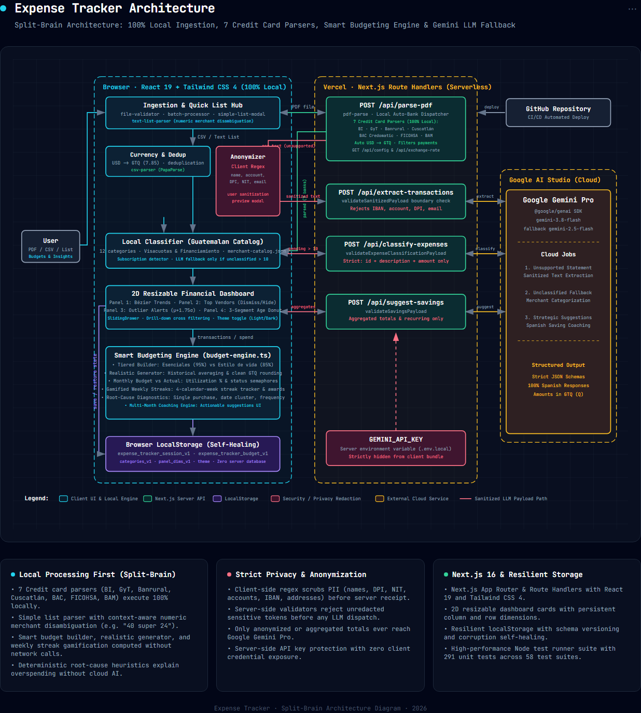

# Architecture Description: Expense Tracker (Control de Gastos)

Expense Tracker is a full-stack Next.js (App Router) application deployed on Vercel. It strictly implements a **Split-Brain Architecture**: all financial computations, document parsing, text list ingestion, multi-currency conversions, data deduplication, privacy redactions, analytical calculations, and budget coaching heuristics execute **100% locally** in the user's browser or in self-contained local Next.js server routines that never communicate with external cloud services.

External Large Language Model (LLM) calls to Google Gemini Pro are isolated, optional fallbacks that receive strictly anonymized text or aggregated numeric totals, with zero exposure of personally identifiable information (PII) or financial account details.

```
+----------------------------------------------------------------------------------------------------+
|                                    SPLIT-BRAIN ARCHITECTURE                                        |
+----------------------------------------------------------------------------------------------------+
|  CLIENT & LOCAL EXECUTION (100% Local / Zero Cloud Leakage)                                        |
|  - Multi-File Batch Processor & Queue (.pdf, .csv)                                                 |
|  - Multi-Bank Credit Card Parsers (BI, GyT, Banrural, Cuscatlan, BAC, FICOHSA, BAM)                 |
|  - Context-Aware Simple Expense List Parser & Numeric Merchant Disambiguation                      |
|  - Local Merchant Catalog & Rule Classifier (12 Guatemalan categories)                             |
|  - Deterministic Budgeting Engine: Tiered presets, realistic targets, budget vs actual,             |
|    gamified weekly streaks, root-cause diagnostics, and actionable coaching insights                |
|  - SVG 4-Panel Analytics Dashboard with 2D Resizable Grid & Sliding Drawer                         |
|  - PII Regex Anonymizer & Interactive User Sanitization Preview                                     |
|  - Resilient LocalStorage Persistence (Sessions, Categories, Budgets, Panel Dims)                  |
+----------------------------------------------------------------------------------------------------+
                                      | (Sanitized / Aggregated Only)
                                      v
+----------------------------------------------------------------------------------------------------+
|  NEXT.JS ROUTE HANDLERS (Vercel Node.js Server Boundary)                                           |
|  - Strict boundary validators: validateSanitizedPayload, validateExpenseClassificationPayload     |
|  - Runtime configuration (/api/config) & exchange rates (/api/exchange-rate)                       |
|  - Gemini API Key isolation (server-side only, never leaked to client)                             |
+----------------------------------------------------------------------------------------------------+
                                      | (HTTPS / Encrypted Cloud API)
                                      v
+----------------------------------------------------------------------------------------------------+
|  EXTERNAL CLOUD SERVICES                                                                           |
|  - Google Gemini Pro (Google AI Studio via @google/genai SDK): Fallback extraction & suggestions   |
|  - Vercel: Edge deployment & serverless hosting                                                    |
+----------------------------------------------------------------------------------------------------+
```

---

## 1. Actors & User Journeys

* **User (Guatemala / Personal Finance):**
  * **Ingestion:** Uploads bank statement PDFs, CSV spreadsheets, or pastes quick expense lists ("Lista rápida").
  * **Inspection:** Explores spending via the 4-panel analytical dashboard with 2D resizable cards, category curves, vendor rankings, timing distributions, and installment breakdowns.
  * **Triage & Exploration:** Opens the sliding transaction drawer (`SlidingDrawer`) to filter by currency (GTQ/USD), search merchants, re-classify items, or add custom categories.
  * **Budgeting & Coaching:** Defines monthly spending targets from scratch or generates realistic targets based on past spending, tracks weekly streaks, and reviews root-cause overspending diagnostics.
  * **Privacy Control:** Previews and edits sanitized text before any optional LLM fallback extraction.

---

## 2. System Components & Architecture Boundaries

### 2.1. Browser Client (React 19 + Tailwind CSS 4)

* **Page Orchestrator (`src/app/page.tsx`):**
  * Manages primary application state, active session continuity, navigation between Landing, Dashboard, and Budget views, modal triggers, and toast notifications.

* **Dedicated Budgeting Tool (`src/components/budget-tool-view.tsx` & `src/lib/budget-engine.ts`):**
  * **Tiered Category Presets:** Suggests logical spending limits split into *Esenciales* (Supermercado, Servicios Básicos, Salud, Transporte) and *Estilo de vida* (Restaurantes, Entretenimiento, Suscripciones).
  * **Realistic Target Generator:** Uses historical monthly averages (95% essential, 85% discretionary) with clean Quetzal rounding (multiples of Q 5, Q 10, Q 25).
  * **Monthly Comparison Engine:** Computes real spending vs budget targets, net savings/excess, utilization percentages, and status semaphores (`under`, `near`, `over`, `way_over`).
  * **Gamification & Weekly Streaks:** Computes 4-calendar-week consecutive budget streaks, categories achieved, and "Mejor categoría del mes".
  * **Root-Cause Analyzer:** Categorizes budget overruns into `compra_unica_alta`, `alta_frecuencia`, `concentracion_fechas`, or `monto_total_elevado`.
  * **Multi-Month Coaching:** Tracks historical category trajectories (1-2 months vs 3+ months continuous overruns) to propose corrective actions or target adjustments.

* **2D Resizable Financial Dashboard (`src/components/dashboard-view.tsx` & `resizable-panel.tsx`):**
  * **Panel 1 (`category-trend-chart.tsx`):** Historical category trends via cubic Bézier curves, multi-category selection, and adaptive SVG scaling.
  * **Panel 2 (`vendor-concentration-chart.tsx`):** Top 5 merchant spend vs frequency ranking, ticket averages, and vendor dismissal/hiding.
  * **Panel 3 (`consumption-patterns-chart.tsx`):** 7-day weekly vs 31-day monthly histograms with statistical outlier alerts ($\mu + 1.75\sigma$).
  * **Panel 4 (`transaction-age-chart.tsx`):** 3-segment donut visualization (Visacuotas/Financiamiento, Suscripciones, Compras Inmediatas).
  * **2D Resizable Grid:** Custom column split and row height adjustment with boundary clamping and dimension persistence.

* **Simple Expense List Ingestion (`src/components/simple-list-modal.tsx` & `src/lib/text-list-parser.ts`):**
  * Allows free-text pasting/typing of daily expenses (`"Walmart 150"`, `"150 Burger King"`, `"40 super 24"`).
  * Context-aware numeric vendor disambiguation: correctly differentiates numbers belonging to merchant names (e.g. *Super 24*) from transaction amounts.

* **Sliding Transaction Drawer (`src/components/sliding-drawer.tsx` & `transaction-table.tsx`):**
  * Off-canvas panel with backdrop blur, full-text search, category and currency filtering (All, GTQ, Converted USD), manual editing, and custom category creation.

* **Local Parsers & Financial Utilities (`src/lib`):**
  * `batch-processor.ts`: Ordered multi-file upload queue.
  * `deduplication.ts`: Exact transaction deduplication across files and active sessions.
  * `currency.ts`: Formats GTQ (Q) and converts USD to GTQ at the configured exchange rate (default 7.85).
  * `csv-parser.ts`: Fast local CSV parsing via PapaParse with column auto-detection and interactive mapping.
  * `anonymizer.ts`: Client-side PII scrubbing (names, accounts, IBAN, DPI, NIT, emails, addresses).
  * `expense-classifier.ts`: Deterministic matching against `merchant-catalog.json` (Guatemalan catalog).
  * `storage.ts`: LocalStorage management with corruption self-healing and versioned schemas:
    * `expense_tracker_session_v1`: Active transaction session.
    * `expense_tracker_categories_v1`: User custom categories.
    * `expense_tracker_budget_v1`: Versioned monthly budget configurations.
    * `expense_tracker_panel_dims_v1`: Custom dashboard panel dimensions.
    * `theme`: User theme preference (light/dark).

### 2.2. Next.js Server Boundary (Route Handlers on Vercel)

* **`/api/config` (GET):** Serves runtime configurations (e.g., `unclassifiedExpensesThreshold: 10`).
* **`/api/exchange-rate` (GET):** Serves the active USD to GTQ exchange rate.
* **`/api/parse-pdf` (POST):**
  * Local PDF text extraction via `pdf-parse`.
  * **Credit Card Multi-Bank Dispatcher:** Inspects header metadata, issuer tags, and card branding to automatically dispatch to dedicated credit card parsers:
    1. **Banco Industrial (BI)** (`bi-parser.ts`)
    2. **Banco G&T Continental** (`gyt-parser.ts`)
    3. **Banrural** (`banrural-parser.ts`)
    4. **Banco Cuscatlán** (`cuscatlan-parser.ts`)
    5. **BAC Credomatic** (`bac-parser.ts`)
    6. **Banco FICOHSA** (`ficohsa-parser.ts`)
    7. **Banco Agromercantil (BAM)** (`bam-parser.ts`)
  * If the statement is recognized, returns structured transactions locally classified with currency conversion. If unsupported, returns raw text for client-side anonymization.
* **`/api/extract-transactions` (POST):**
  * Boundary validation: `validateSanitizedPayload` blocks unredacted accounts, IBANs, DPIs, or emails.
  * Calls Gemini Pro to extract transaction records from unrecognized formats.
* **`/api/classify-expenses` (POST):**
  * Boundary validation: `validateExpenseClassificationPayload` allows only IDs, sanitized descriptions, and amounts.
  * Fallback classification invoked only when unclassified items exceed the threshold.
* **`/api/suggest-savings` (POST):**
  * Boundary validation: `validateSavingsPayload` enforces that only aggregated category totals and recurring services are sent.
  * Invokes Gemini Pro for market-specific financial advice.

### 2.3. External Cloud Services

* **Google Gemini Pro (`@google/genai`):** Model cascade (`gemini-3.8-flash` -> `gemini-2.5-flash`). Structured JSON responses in Spanish.
* **Vercel:** Zero-configuration Next.js deployment. Server-side environment variables (`GEMINI_API_KEY`) remain strictly confidential.
* **GitHub:** Continuous integration and version control.

---

## 3. Data Flow & Security Boundaries

```
[User]
   |
   +---> Uploads PDF / CSV / Quick Text List
   |
   v
[Browser Client]
   |
   |-- (CSV / Text List) ---------> Local Parser (PapaParse / text-list-parser)
   |                                 └─> Local Classifier & Deduplication -> Dashboard & Budget
   |
   |-- (PDF Upload) ---------------> POST /api/parse-pdf (Server-side local)
   |                                 ├─> Auto-Detect Credit Card Bank (BI, GyT, Banrural, Cuscatlan, BAC, Ficohsa, BAM)
   |                                 └─> Supported? -> Return parsed & converted transactions
   |                                                -> Unsupported? -> Return raw text
   |
   |-- (Unsupported PDF Flow) -----> Anonymizer (Regex scrub PII)
   |                                 └─> User Sanitization Preview Modal
   |                                       └─> POST /api/extract-transactions (Sanitized text only)
   |                                             └─> Gemini Pro -> Structured JSON
   |
   |-- (Budget Planning) ----------> Budget Engine (100% Local)
   |                                 ├─> Tiered presets or Historical generator
   |                                 ├─> Monthly comparison & weekly streaks
   |                                 └─> Root-cause diagnostics & multi-month coaching
   |
   +<-- Persistence ---------------> localStorage (Session, Budgets, Categories, Panel Dims)
```

---

## 4. Visual Architecture Diagram

A self-contained, interactive architecture diagram is available at [architecture-diagram.html](file:///c:/Users/luisr/expense-tracker/architecture-diagram.html) and rendered below:


