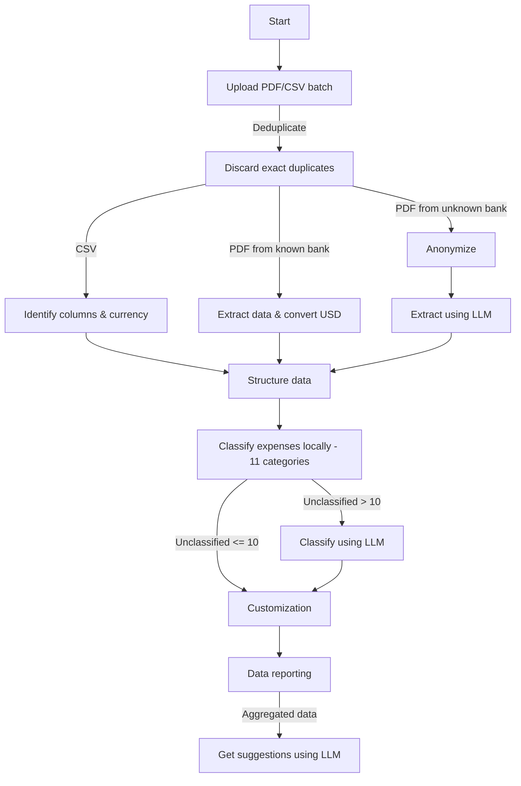

# Control de Gastos Personales (Expense Tracker)

Aplicación para el control y reducción de gastos mensuales a partir de estados de cuenta bancarios (PDF) o archivos de movimientos (CSV).

La aplicación implementa una arquitectura **Split-Brain (Cerebro Dividido)**: todos los datos personales y el procesamiento principal se gestionan de forma local, utilizando inteligencia artificial externa (Google Gemini Pro) únicamente sobre datos previamente anonimizados o métricas agregadas para clasificar gastos pendientes y generar recomendaciones de ahorro.

---

## 1. ¿Qué hace la aplicación?

* **Importación y Carga por Lotes de Estados de Cuenta**:
  * **Carga Múltiple y Cola por Lotes**: Permite cargar uno o varios archivos simultáneamente (.pdf y .csv). Un modal de gestión muestra la cola de procesamiento, estado individual de cada documento y progreso global acumulado.
  * **Deduplicación Inteligente**: Descarta de forma automática transacciones exactamente duplicadas (misma fecha, descripción idéntica y mismo monto) tanto dentro del lote como frente a la sesión activa, protegiendo compras legítimas con datos similares y notificando al usuario con transparencia.
  * **Conversión Multi-Moneda (USD a GTQ)**: Extrae transacciones en dólares estadounidenses (`$`) tanto de estados de cuenta PDF de Banco G&T como de archivos CSV, convirtiéndolas automáticamente a Quetzales según la tasa de cambio oficial (por defecto Q 7.85 por USD) y conservando la divisa original en metadatos para visualización y filtrado.
  * **Estados de Cuenta en PDF**: Extrae el texto de manera local. Si el documento proviene de un banco con parser propio (**Banco G&T Continental**), procesa los consumos automáticamente filtrando pagos de tarjeta y créditos. Si proviene de otro banco, anonimiza localmente el texto y utiliza Gemini Pro para extraer las transacciones en formato estructurado.
  * **Archivos CSV**: Permite cargar hojas de cálculo de movimientos mediante **PapaParse**. Si las columnas son ambiguas, ofrece un asistente visual para mapear fecha, descripción, monto y divisa.
* **Privacidad Estricta (Split-Brain)**:
  * Redacta de forma local nombres del titular, transferencias ACH, números de cuenta, IBAN, números de tarjeta, DPI (CUI), NIT, direcciones físicas, correos electrónicos y teléfonos antes de cualquier llamada externa.
  * Cuenta con un **modal interactivo de censura** donde el usuario valida el texto redactado y puede agregar términos personalizados antes de autorizar su envío al LLM.
* **Clasificación Inteligente y Adaptativa**:
  * Cruza las transacciones con un **catálogo local de 11 categorías de comercios de Guatemala** (`merchant-catalog.json`), reconociendo de inmediato supermercados, restaurantes, gasolineras, servicios básicos, salud, hogar, educación, mascotas y suscripciones.
  * Si quedan más de 10 gastos sin categorizar, consulta a Gemini Pro para sugerir categorías. Si son 10 o menos, evita llamadas innecesarias para ahorrar costos y permite clasificación manual.
* **Detección Automática de Suscripciones**:
  * Detecta cobros periódicos (Netflix, Spotify, etc.), calcula el compromiso mensual en Quetzales y alerta al usuario sobre servicios activos.
* **Gestión, Filtrado y Personalización Completa**:
  * Tabla interactiva con búsqueda en tiempo real, filtros por categoría y por moneda (Todas, Solo GTQ, Convertidas de USD con badges explicativos), edición de montos y fechas, asignación masiva, borrado de movimientos y creación de categorías personalizadas con colores propios.
* **Panel de Estadísticas y Reportes**:
  * Visualización de distribución de gastos por categoría, porcentajes del presupuesto total y comparativas financieras.
* **Sugerencias de Ahorro con IA**:
  * Envía **únicamente** totales consolidados por categoría y el listado de suscripciones para que Gemini Pro genere oportunidades inmediatas de ahorro, estrategias a largo plazo y diagnóstico por categoría adaptadas a Guatemala.
* **Continuidad de Sesión y Reinicio Selectivo**:
  * Mantiene la sesión activa incremental en el `localStorage` del navegador (nuevos archivos agregan compras sin sobreescribir). Dispone de un modal explícito de reinicio que permite limpiar las transacciones conservando las categorías personalizadas del usuario, o realizar un restablecimiento de fábrica total.

---

## 2. Flujo de Ejecución

El siguiente diagrama ilustra el flujo de ejecución del sistema:



### Descripción del Flujo

1. **Carga y Deduplicación**: El usuario sube uno o múltiples estados de cuenta en PDF o archivos CSV. El sistema descarta duplicados exactos frente a compras previas.
2. **Detección de Formato y Conversión Multi-Moneda**:
   * Si es **CSV**, se identifican las columnas y la divisa localmente.
   * Si es **PDF de banco conocido** (Banco G&T), se extraen los consumos en GTQ y se convierten a Quetzales los consumos en USD (7.85) de forma local y determinista.
   * Si es **PDF de banco no soportado**, se ejecuta la anonimización local de PII, el usuario confirma el texto censurado y Gemini Pro extrae las transacciones.
3. **Estructuración**: Los movimientos se estandarizan en un objeto JSON en memoria; a partir de este punto, el archivo original no se vuelve a utilizar.
4. **Clasificación Local**: Se categorizan los gastos usando el catálogo de 11 categorías de comercios de Guatemala.
5. **Evaluación de Pendientes**:
   * Si quedan `<= 10` gastos sin clasificar, se pasa directo a la personalización manual (ahorro de llamadas de IA).
   * Si quedan `> 10` gastos sin clasificar, Gemini Pro clasifica los pendientes de forma asistida.
6. **Revisión y Personalización**: El usuario revisa, ajusta filtros (categoría, moneda), o añade categorías personalizadas.
7. **Reportes y Sugerencias**: Se generan gráficos y métricas consolidadas. Opcionalmente, se envían únicamente los totales agregados al LLM para obtener recomendaciones de ahorro.

---

## 3. Instalación, Configuración y Ejecución

### Requisitos Previos
* **Node.js**: v20+ o v22+ LTS recomendado.
* **npm**: v10+.
* **Clave de API de Gemini**: Obtenida en [Google AI Studio](https://aistudio.google.com/).

### Pasos

```bash
# 1. Clonar el repositorio
git clone https://github.com/tu-usuario/expense-tracker.git
cd expense-tracker

# 2. Instalar dependencias
npm install

# 3. Configurar variables de entorno
cp .env.example .env.local
# (En Windows PowerShell: Copy-Item .env.example .env.local)
```

Edita `.env.local` y añade tu clave:

```env
GEMINI_API_KEY=tu_clave_de_gemini_aqui
```

```bash
# 4. Iniciar el servidor de desarrollo
npm run dev

# Opcional. Ejecutar la suite de pruebas unitarias
npm test
```

Abre tu navegador en [http://localhost:3000](http://localhost:3000).

> Para obtener instrucciones completas sobre compilación para producción (`npm run build`), linters y despliegue en Vercel, consulta la [Guía de Instalación y Ejecución](docs/instalacion-y-ejecucion.md).

---

## 4. Índice de Documentación del Proyecto

La documentación detallada se encuentra organizada en la carpeta [`docs/`](docs/) para facilitar su lectura y navegación en GitHub:

1. **[Guía de Instalación, Configuración y Ejecución](docs/instalacion-y-ejecucion.md)**  
   *Requisitos previos, configuración de variables de entorno, comandos de compilación, ejecución y despliegue en Vercel.*

2. **[Estructura del Proyecto](docs/estructura-del-proyecto.md)**  
   *Árbol completo de directorios, capas de la aplicación (App Router, componentes, librerías, catálogos) y responsabilidades de cada módulo.*

3. **[Arquitectura Split-Brain (Cerebro Dividido)](docs/arquitectura-split-brain.md)**  
   *Explicación conceptual de la arquitectura, tablas comparativas de procesamiento local vs. LLM externo y las 4 razones de diseño: Privacidad, Costo, Latencia y Completitud.*

4. **[Herramientas y Arquitectura Técnica](docs/herramientas-y-arquitectura.md)**  
   *Tablas detalladas de responsabilidades (Navegador, Servidor Next.js, Gemini API), pila tecnológica completa y diagrama de arquitectura del sistema.*

5. **[Uso del LLM Externo y Manejo de Fallos](docs/uso-del-llm-y-manejo-de-fallos.md)**  
   *Para qué se usa exactamente el LLM, estructura de payloads, cascada de modelos de fallback y cómo la aplicación continúa operando al 100% ante fallos de conexión o cuota.*

6. **[Privacidad y Anonimización de Datos](docs/privacidad-y-anonimizacion.md)**  
   *Filosofía de privacidad por diseño, fragmentos de código de expresiones regulares, heurística de detección de titular, validación estricta de servidor y censura interactiva.*

7. **[Pruebas Unitarias y Cobertura](docs/pruebas-unitarias.md)**  
   *Cómo ejecutar las pruebas con Node.js Test Runner y desglose exhaustivo de los 14 archivos de prueba (26 suites, 117 pruebas unitarias).*

---

## 5. Stack de Tecnologías

* **Framework Full-Stack**: [Next.js 16](https://nextjs.org/) (App Router, Route Handlers)
* **Biblioteca de UI**: [React 19](https://react.dev/)
* **Lenguaje**: [TypeScript 5](https://www.typescriptlang.org/)
* **Estilos**: [Tailwind CSS 4](https://tailwindcss.com/)
* **Inteligencia Artificial**: [Google Gen AI SDK (`@google/genai`)](https://www.npmjs.com/package/@google/genai)
* **Procesamiento de Documentos**: [pdf-parse](https://www.npmjs.com/package/pdf-parse) y [PapaParse](https://www.papaparse.com/)
* **Iconografía**: [Lucide React](https://lucide.dev/)
* **Testing**: Node.js Test Runner con [tsx](https://github.com/privatenumber/tsx)
* **Hosting**: [Vercel](https://vercel.com/)
