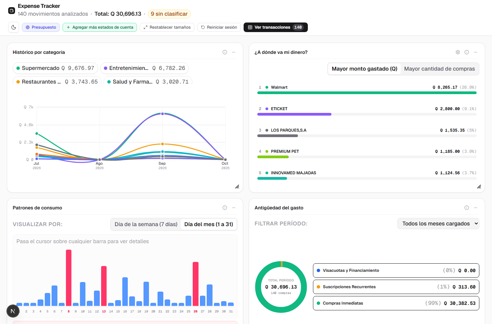
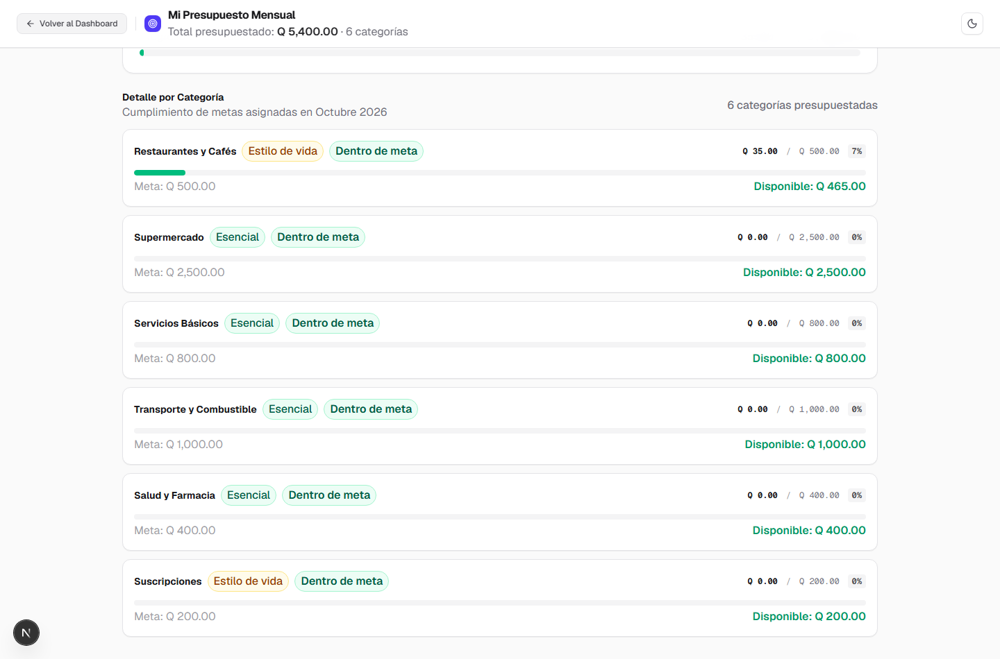
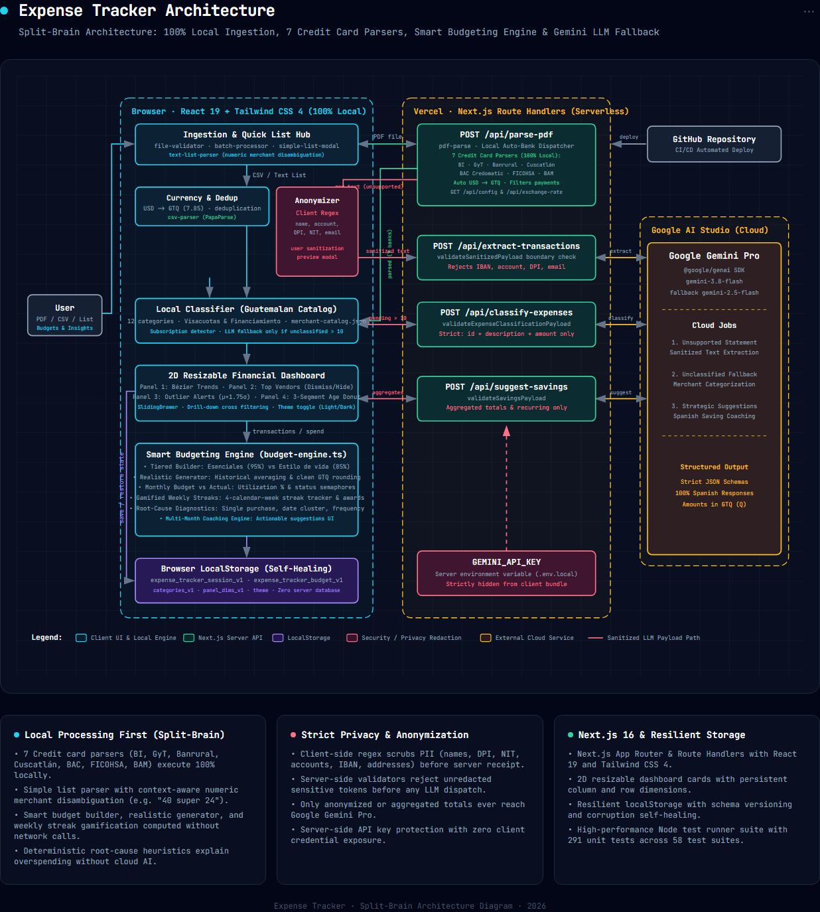

# Expense Tracker — Control de Gastos Personales

Aplicación web moderna y segura para el control, análisis y optimización de finanzas personales a partir de estados de cuenta de tarjetas de crédito (PDF), archivos CSV y listas rápidas de gastos en texto libre. Diseñada para operar en Quetzales (GTQ) bajo una **Arquitectura Split-Brain** que procesa el 100% de la información sensible de forma local, protegiendo tu privacidad sin enviar datos financieros a servidores externos.

---

## Vistas Principales

### Tablero Financiero Analítico
Vista consolidada de 4 paneles SVG interactivos y redimensionables en 2D, con métricas en Quetzales y acceso al panel lateral deslizante de movimientos.



### Planificador y Comparador de Presupuestos
Define metas por categorías (Esenciales y Estilo de vida) desde cero o con el generador realista, monitorea el avance del mes, acumula rachas semanales y consulta diagnósticos de causa raíz.



---

## Puntos Destacados y Funcionalidades Clave

* **Visualización y Analítica en Tiempo Real (Tablero 4 Paneles):**
  * *Tendencia Histórica:* Curvas continuas Bézier por categoría con selector interactivo.
  * *¿A dónde va mi dinero?:* Concentración de comercios por monto o frecuencia, cálculo de ticket promedio y opción para ocultar compras fijas.
  * *Patrones de Consumo:* Detección estadística automática de consumos atípicos ($\mu + 1.75\sigma$) en vistas semanales o mensuales.
  * *Antigüedad y Financiamiento:* Segmentación de compras inmediatas, suscripciones y cuotas (Visacuotas).
  * *Paneles Redimensionables 2D:* Ajusta libremente el ancho y alto de cada panel con memoria persistente.

* **Módulo de Presupuestos Inteligente (100% Local):**
  * *Construcción Flexible:* Plantillas por niveles (Esenciales vs. Estilo de vida) o generador automático a partir de tu promedio de gastos reales.
  * *Comparativa Mensual:* Semáforo visual de ejecución (`under`, `near`, `over`, `way_over`) y alertas de categorías no presupuestadas.
  * *Gamificación:* Rachas semanales cumplidas (partición en 4 semanas de calendario) y reconocimiento a la mejor categoría de ahorro.
  * *Diagnóstico de Causas Raíz y Coaching:* Identifica compras atípicas únicas, concentración de fechas o alta frecuencia, con sugerencias accionables para el mes siguiente.
  * *Versiones Históricas:* Aplica cambios de presupuesto hacia adelante o retrospectivamente con confirmación de alcance.

* **Carga Multi-Banco y Lista Rápida de Gastos:**
  * *7 Bancos de Guatemala:* Procesamiento automático local de estados de cuenta de tarjetas de crédito de **Banco Industrial (BI)**, **Banco G&T Continental**, **Banrural**, **Banco Cuscatlán**, **BAC Credomatic**, **Banco FICOHSA** y **Banco Agromercantil (BAM)**.
  * *Lista Rápida en Texto:* Pega o escribe compras en lenguaje natural (`"Walmart 150"`, `"40 super 24"`) con desambiguación numérica de comercios.
  * *Carga por Lotes y Deduplicación:* Subida múltiple simultánea (PDF y CSV) con omisión automática de compras duplicadas.
  * *Conversión Automática USD a GTQ:* Detección y conversión a Quetzales manteniendo la referencia en moneda extranjera.

* **Privacidad por Diseño (Arquitectura Split-Brain):**
  * Todo el procesamiento de documentos, extracción, clasificación y presupuestos se ejecuta localmente.
  * Tus datos personales y financieros nunca se comparten. El modelo en la nube (Google Gemini Pro) se invoca únicamente como respaldo opcional ante bancos desconocidos, recibiendo texto previamente censurado.

---

## Inicio Rápido

### Requisitos Previos
* **Node.js**: `v20+` o `v22+` LTS recomendado.
* **npm**: `v10+`.
* **Clave de API de Gemini**: Opcional, requerida únicamente para la extracción de estados de cuenta de bancos no reconocidos y sugerencias de ahorro ([Google AI Studio](https://aistudio.google.com/)).

### Instalación y Ejecución

```bash
# 1. Clonar el repositorio
git clone https://github.com/tu-usuario/expense-tracker.git
cd expense-tracker

# 2. Instalar dependencias
npm install

# 3. Configurar variables de entorno
cp .env.example .env.local
# (En Windows PowerShell: Copy-Item .env.example .env.local)

# 4. Iniciar servidor de desarrollo
npm run dev

# 5. Ejecutar suite de pruebas unitarias (291 tests)
npm test

# 6. Ejecutar pruebas End-to-End con Playwright
npm run test:e2e
```

Abre tu navegador en [http://localhost:3000](http://localhost:3000).

---

## Arquitectura del Sistema

El sistema implementa una estricta separación de responsabilidades donde el 100% de la lógica sensible corre en el cliente o servidor local, con validadores de frontera antes de cualquier llamada opcional a la nube.



> Puedes explorar e interactuar con el diagrama completo en [architecture-diagram.html](architecture-diagram.html) o consultar la especificación en [ARCHITECTURE_DIAGRAM.md](ARCHITECTURE_DIAGRAM.md).

---

## Índice de Documentación Detallada

Para consultar la documentación técnica completa, algoritmos y guías de desarrollo, revisa los siguientes documentos:

| Documento | Descripción |
| :--- | :--- |
| **[Implementación del Módulo de Presupuestos](docs/dev/iteration_4/BUDGET_IMPLEMENTATION.md)** | Especificación técnica del motor presupuestario, persistencia, versionado, causas raíz y reporte de QA (US-054 a US-063). |
| **[Herramientas y Arquitectura Técnica](docs/herramientas-y-arquitectura.md)** | Responsabilidades por capas (cliente, servidor local, nube), parsers bancarios y componentes visuales. |
| **[Arquitectura de Privacidad Split-Brain](docs/arquitectura-split-brain.md)** | Fundamentos de privacidad, costo, latencia y fronteras de datos locales vs. externos. |
| **[Diagrama de Arquitectura y Flujos](ARCHITECTURE_DIAGRAM.md)** | Descripción de actores, componentes, flujos de datos y mapa interactivo del sistema. |
| **[Privacidad y Anonimización de Datos](docs/privacidad-y-anonimizacion.md)** | Reglas de detección y redacción de PII (DPI, cuentas, nombres, direcciones) y censura interactiva. |
| **[Estructura del Proyecto y Código Fuente](docs/estructura-del-proyecto.md)** | Árbol completo de directorios, capas de aplicación y descripción de cada módulo. |
| **[Guía de Instalación y Despliegue](docs/instalacion-y-ejecucion.md)** | Variables de entorno, scripts de ejecución, compilación de producción y hosting en Vercel. |
| **[Pruebas Unitarias y Automatización E2E](docs/pruebas-unitarias.md)** | Guía de las 291 pruebas unitarias en Node test runner y pruebas de integración con Playwright. |
| **[Uso de Gemini y Manejo de Fallos](docs/uso-del-llm-y-manejo-de-fallos.md)** | Flujo de rescate para formatos desconocidos, cascada de modelos y tolerancia a fallos. |
| **[Encuesta de Evaluación de Producto](ENCUESTA.md)** | Instrumento de validación, preguntas de usabilidad y resultados de entrevistas con usuarios. |

---

## Stack Tecnológico

* **Framework Full-Stack**: [Next.js 16](https://nextjs.org/) (App Router, Turbopack, Route Handlers)
* **Biblioteca de UI**: [React 19](https://react.dev/)
* **Lenguaje**: [TypeScript 5](https://www.typescriptlang.org/)
* **Estilos**: [Tailwind CSS 4](https://tailwindcss.com/)
* **Inteligencia Artificial**: [Google Gen AI SDK (`@google/genai`)](https://www.npmjs.com/package/@google/genai) (Gemini Pro)
* **Procesamiento de Documentos**: [pdf-parse](https://www.npmjs.com/package/pdf-parse) y [PapaParse](https://www.papaparse.com/)
* **Iconografía**: [Lucide React](https://lucide.dev/) (SVG vectoriales sin emojis)
* **Testing Unitario**: Node.js Test Runner con [tsx](https://github.com/privatenumber/tsx) (291 tests)
* **Testing E2E**: [Playwright](https://playwright.dev/)
* **Hosting**: [Vercel](https://vercel.com/)
