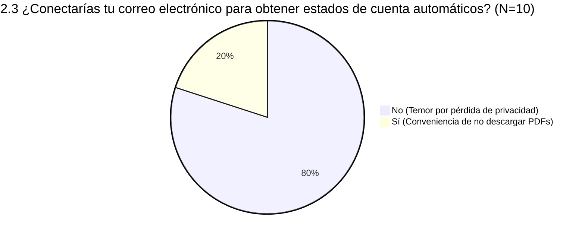
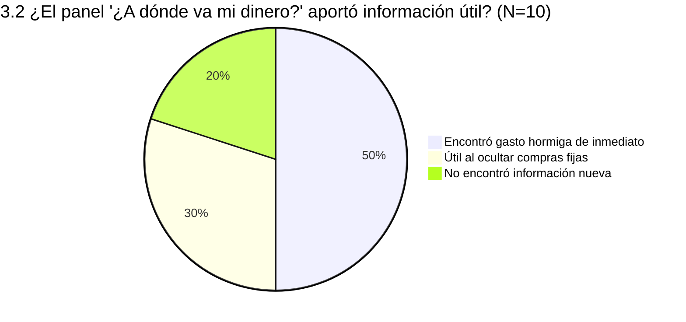
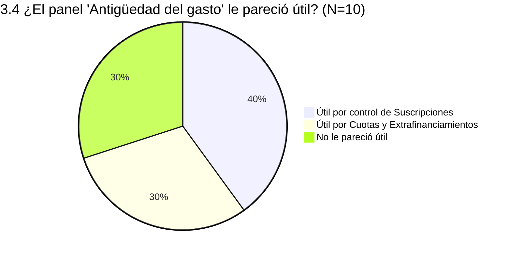
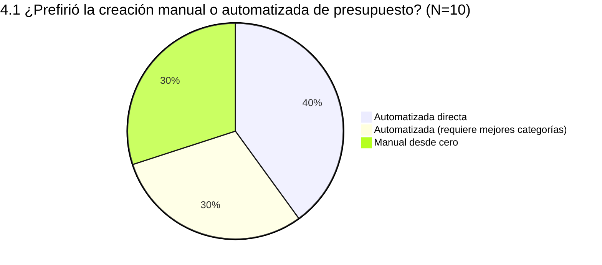
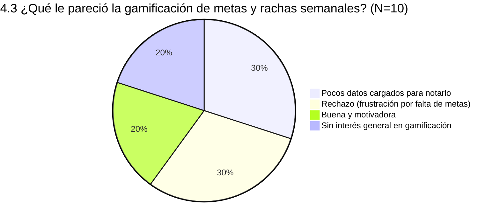
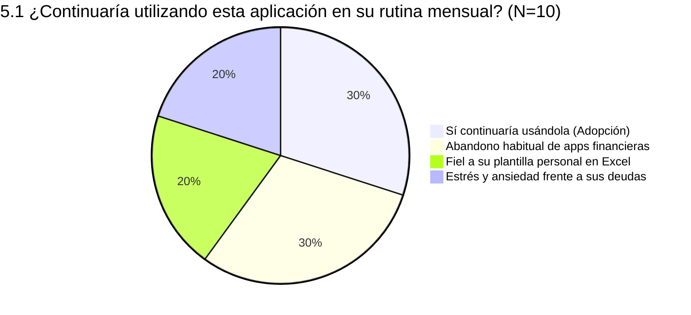
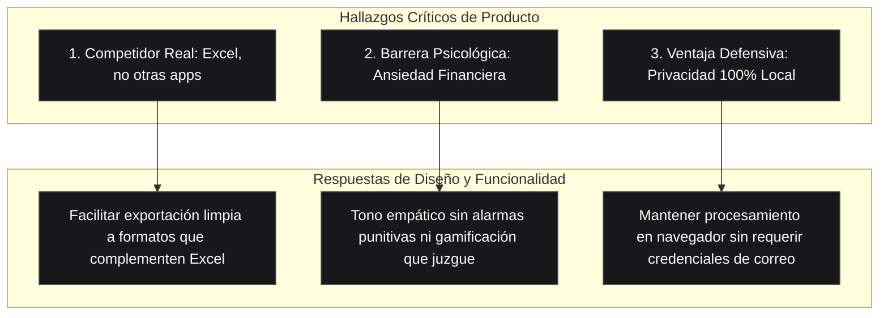

# Resultados Visuales de la Encuesta de Validación de Producto

Informe consolidado de la prueba y entrevista a profundidad realizada con **10 potenciales usuarios** sobre la experiencia de uso, propuesta de valor, usabilidad y fricción psicológica en **Expense Tracker**.

---

## 1. Resumen Ejecutivo (KPIs de Validación)

| Métrica Clave | Distribución Visual (N=10) | Resultado | Implicación Directa para el Producto |
| :--- | :--- | :---: | :--- |
| **Facilidad de Carga** | `[██████████]` | **100%** | La ingesta local resolvió la fricción técnica; el obstáculo real es la descarga previa en el banco. |
| **Claridad del Tablero** | `[███████░░░]` | **70%** | 7/10 comprendieron los paneles; 3/10 reportaron sobrecarga cognitiva inicial al ver 4 paneles a la vez. |
| **Descubrimiento de Fugas** | `[████████░░]` | **80%** | 50% descubrió gastos hormiga de inmediato y 30% tras ocultar comercios principales recurrentes. |
| **Preferencia de Presupuesto**| `[███████░░░]` | **70%** | Fuerte preferencia por el generador automatizado realista frente a la configuración manual desde cero. |
| **Rechazo a Conectar Gmail** | `[████████░░]` | **80%** | Preocupación unánime por privacidad, validando la arquitectura Split-Brain 100% local sin nube. |
| **Retención Continua** | `[███░░░░░░░]` | **30%** | Adopción directa del 30%; el 70% restante enfrenta barreras de hábito (30%), Excel (20%) y estrés (20%). |

---

## 2. Entrada de Datos y Onboarding

### 2.1 ¿Qué tan fácil te resultó cargar tus gastos a la aplicación?

| Nivel de Facilidad | Distribución Visual | Cantidad | Porcentaje |
| :--- | :--- | :---: | :---: |
| **Fácil** | `[████████░░]` | 8 / 10 | 80% |
| **Muy fácil** | `[██░░░░░░░░]` | 2 / 10 | 20% |

> [!NOTE]
> **Fricción externa observada:**
> **5 personas** señalaron que la carga dentro de la app fue inmediata y sin tropiezos *una vez ya tenían descargados sus documentos*, pero que el proceso previo de ingresar a la banca en línea y descargar el PDF/CSV resulta tedioso y desalentador.

---

### 2.2 ¿Qué método de entrada utilizaste?

| Método de Ingesta | Distribución Visual | Cantidad | Porcentaje |
| :--- | :--- | :---: | :---: |
| **PDF o CSV bancario** | `[███████░░░]` | 7 / 10 | 70% |
| **Lista rápida en texto (copiar y pegar)** | `[██░░░░░░░░]` | 2 / 10 | 20% |
| **Ambas modalidades combinadas** | `[█░░░░░░░░░]` | 1 / 10 | 10% |

> [!NOTE]
> **Comportamiento en prueba por privacidad:**
> **2 personas** prefirieron no cargar datos personales reales durante la entrevista y optaron por explorar el sistema utilizando exclusivamente el archivo CSV de prueba brindado.

---

### 2.3 Conexión con correo electrónico para estados automáticos

| Respuesta | Cantidad | Porcentaje | Sentimiento Predominante |
| :--- | :---: | :---: | :--- |
| **No la utilizaría** | 8 / 10 | 80% | Temor severo a comprometer la privacidad de su cuenta personal de correo. |
| **Sí la utilizaría** | 2 / 10 | 20% | Uno de ellos fue quien propuso originalmente la idea la semana previa. |

> [!WARNING]
> **Insight Crítico de Privacidad:**
> Aunque la automatización de descarga eliminaría la fricción de los portales bancarios, el 80% de los usuarios rechaza categóricamente entregar acceso a su bandeja de entrada. La decisión de mantener el procesamiento local sin requerir credenciales externas es un acierto fundamental de producto.

---

### 2.4 Captura fotográfica de facturas

| Disposición de Uso | Distribución Visual | Cantidad | Porcentaje |
| :--- | :--- | :---: | :---: |
| **No la utilizaría** | `[██████░░░░]` | 6 / 10 | 60% |
| **Sí (uso habitual)** | `[███░░░░░░░]` | 3 / 10 | 30% |
| **Solo en fines de semana** | `[█░░░░░░░░░]` | 1 / 10 | 10% |

> [!NOTE]
> **Patrón de uso condicionado:**
> La persona que respondió *"solamente fines de semana"* explicó que de lunes a viernes no suele pedir factura ni guardar recibos, pero durante los fines de semana acumula compras en restaurantes y tiendas físicas, momento en que surge la alarma por el gasto total acumulado.

---

## 3. Dashboard Analítico de 4 Paneles

### 3.1 Claridad y comprensión general del Dashboard

| Percepción del Tablero | Distribución Visual | Cantidad | Porcentaje |
| :--- | :--- | :---: | :---: |
| **Clara y comprensible** | `[███████░░░]` | 7 / 10 | 70% |
| **Demasiada información junta (sobrecarga)** | `[███░░░░░░░]` | 3 / 10 | 30% |

> [!NOTE]
> **Carga cognitiva observada:**
> **3 personas** sintieron sobrecarga informativa al encontrarse con cuatro paneles gráficos desplegados simultáneamente. Sugieren iniciar con una vista simplificada o permitir colapsar paneles secundarios por defecto.

---

### 3.2 Panel: "¿A dónde va mi dinero?" (Concentración de Comercios)

| Experiencia con el Panel | Cantidad | Porcentaje | Detalle Observado |
| :--- | :---: | :---: | :--- |
| **Encontró gastos hormiga de inmediato** | 5 / 10 | 50% | Identificó comercios frecuentes con impacto acumulado imprevisto. |
| **Útil tras ocultar comercios principales** | 3 / 10 | 30% | Necesitó descartar compras grandes fijas (supermercado) para desenterrar compras secundarias. |
| **Sin información nueva** | 2 / 10 | 20% | Ya tenía total conocimiento de sus principales proveedores. |

> [!TIP]
> **Validación de la Interacción UX:**
> La función de descartar/ocultar comercios con un clic fue determinante para que el **30% de los entrevistados** pudiera descubrir fugas de dinero que estaban eclipsadas por los gastos fijos mayores.

---

### 3.3 Panel: "Patrones de consumo" (Día de Semana vs Día de Mes)

| Utilidad Percibida | Distribución Visual | Cantidad | Porcentaje |
| :--- | :--- | :---: | :---: |
| **No aportó información nueva** | `[████████░░]` | 8 / 10 | 80% |
| **Aportó información útil** | `[██░░░░░░░░]` | 2 / 10 | 20% |

> [!NOTE]
> **Falta de valor diferencial:**
> La mayoría de entrevistados comentó que *"ya sabía de antemano que en fines de semana gasta más"*. Ver reflejada la obviedad en un gráfico confirmó su intuición, pero no les brindó recomendaciones accionables ni beneficios prácticos nuevos.

---

### 3.4 Panel: "Antigüedad del gasto" (Cuotas, Suscripciones y Compras del Mes)

| Foco de Utilidad | Cantidad | Porcentaje | Reacción de los Usuarios |
| :--- | :---: | :---: | :--- |
| **Vigilancia de suscripciones fijas** | 4 / 10 | 40% | Permite detectar cobros recurrentes y evaluar cancelaciones. |
| **Seguimiento de cuotas (Visacuotas)** | 3 / 10 | 30% | Claridad sobre deuda arrastrada de compras de meses anteriores. |
| **No le pareció útil** | 3 / 10 | 30% | No tienen suscripciones ni compras financiadas en cuotas. |

> [!NOTE]
> **Impacto emocional frente al endeudamiento:**
> Dos usuarios con compras en cuotas y extrafinanciamientos mostraron **incomodidad y preocupación visible** durante la prueba: aunque sabían que tenían esas deudas, ver gráficamente el porcentaje de ingresos que absorben cada mes les provocó estrés directo.

---

## 4. Módulo de Presupuestos y Gamificación

### 4.1 Preferencia: Creación Manual vs Generador Automatizado

| Método Preferido | Cantidad | Porcentaje | Oportunidad Identificada |
| :--- | :---: | :---: | :--- |
| **Generador automatizado directo** | 4 / 10 | 40% | Agradecieron metas realistas basadas en promedios históricos. |
| **Automatizado, pero pide mejores categorías** | 3 / 10 | 30% | Desean categorías más representativas del contexto local guatemalteco. |
| **Creación manual desde cero** | 3 / 10 | 30% | Prefieren control minucioso sobre cada límite establecido. |

> [!NOTE]
> **Oportunidad de Producto:**
> El **70% favorece la automatización**, pero el 30% remarcó que el catálogo inicial de categorías debe ajustarse mejor a la realidad económica local para minimizar recategorizaciones manuales.

---

### 4.2 Indicador de Avance "Dentro del Presupuesto"

| Evaluación del Semáforo | Distribución Visual | Cantidad | Porcentaje |
| :--- | :--- | :---: | :---: |
| **Buena y clara** | `[████░░░░░░]` | 4 / 10 | 40% |
| **Buena, pero la interfaz debe pulirse** | `[████░░░░░░]` | 4 / 10 | 40% |
| **No se ajusta a sus hábitos** | `[██░░░░░░░░]` | 2 / 10 | 20% |

> [!NOTE]
> **Ritmo de gasto desincronizado:**
> Un participante destacó que le causaría estrés ver el semáforo en rojo rápidamente, ya que realiza la mayoría de compras grandes y pagos fuertes en la **primera semana del mes**. El sistema debe contemplar la distribución temporal del presupuesto.

---

### 4.3 Gamificación, Rachas y Contador de Metas

| Reacción ante la Gamificación | Cantidad | Porcentaje | Diagnóstico Conductual |
| :--- | :---: | :---: | :--- |
| **Insuficientes datos para apreciarla** | 3 / 10 | 30% | Solo cargaron un estado de cuenta; no vieron evolución temporal. |
| **Rechazo por falta de metas logradas** | 3 / 10 | 30% | Sentimiento de frustración y castigo al ver contadores en cero. |
| **Le pareció buena** | 2 / 10 | 20% | Usuarios en superávit que valoraron el refuerzo positivo. |
| **Desinterés general** | 2 / 10 | 20% | Consideran que la gamificación no encaja con herramientas financieras serias. |

> [!WARNING]
> **Riesgo de Percepción Punitiva:**
> La gamificación tuvo un efecto contraproducente en usuarios con sobregasto o deudas: al no tener metas alcanzadas, los indicadores vacíos acentuaron la sensación de fracaso en lugar de motivar.

---

## 5. Decisión de Retención y Barreras de Adopción

| Disposición de Uso | Cantidad | Porcentaje | Perfil del Usuario y Causa Raíz |
| :--- | :---: | :---: | :--- |
| **Sí continuaría usándola** | 3 / 10 | 30% | Personas que valoraron el ahorro de tiempo, la visualización de gastos y la deduplicación automática. |
| **No: Abandona apps por hábito** | 3 / 10 | 30% | Historial de descargar aplicaciones financieras y dejarlas de usar por fatiga o falta de constancia. |
| **No: Prefiere su propio Excel** | 2 / 10 | 20% | Usuarios con alta disciplina que ya cuentan con hojas de cálculo diseñadas a su medida. |
| **No: Estrés y evasión financiera** | 2 / 10 | 20% | Usuarios con deudas que evitan confrontar sus finanzas por angustia y culpa. |

---

## 6. Conclusiones Estratégicas para el Producto

1. **El competidor real es Excel, no otra app de finanzas:**  
   Los usuarios disciplinados ya tienen hojas de cálculo hechas a su medida. Para conquistarlos, la aplicación no debe competir contra su hoja de cálculo, sino servir como la herramienta más rápida para extraer, limpiar y categorizar sus estados de cuenta locales sin digitación manual.
2. **La barrera del estrés y la evasión financiera:**  
   Varios entrevistados expresaron ansiedad vinculada al dinero: confrontar sus deudas o la inflación les genera culpa y angustia (*"dejé de usar una app porque todo subía de precio, subían mis gastos y mi sueldo no sube"*). La aplicación debe evolucionar hacia un tono de acompañamiento y alivio, evitando señales visuales excesivamente alarmistas.
3. **Privacidad como valor irrenunciable:**  
   El rechazo del 80% a la conexión con correo electrónico confirma que la arquitectura Split-Brain y el procesamiento 100% local en el navegador representan una ventaja competitiva fundamental frente a alternativas en la nube.
