# Resultados Visuales de la Encuesta de Validación de Producto

Informe consolidado de la prueba y entrevista a profundidad realizada con **10 potenciales usuarios** sobre la experiencia de uso, propuesta de valor y fricción percibida en **Expense Tracker**.

---

## Resumen Ejecutivo de Métricas Clave

```mermaid
flowchart LR
    subgraph Facilidad["1. Onboarding"]
        direction TB
        F1["Carga fácil o muy fácil: 100%"]
        F2["Preferencia PDF/CSV: 70%"]
    end
    subgraph Dashboard["2. Visualización"]
        direction TB
        D1["Claridad general: 70%"]
        D2["Descubrió gastos hormiga: 80%"]
    end
    subgraph Presupuesto["3. Planificación"]
        direction TB
        P1["Preferencia generación auto: 70%"]
        P2["Aceptación de control: 80%"]
    end
    subgraph Retencion["4. Adopción"]
        direction TB
        R1["Uso continuo inmediato: 30%"]
        R2["Fricción emocional/ansiedad: 20%"]
    end

    Facilidad --> Dashboard --> Presupuesto --> Retencion

    classDef default fill:#18181b,stroke:#3f3f46,color:#fafafa
    classDef highlight fill:#1e3a8a,stroke:#3b82f6,color:#fafafa
```

---

## 1. Entrada de Datos y Onboarding

### 1.1 ¿Qué tan fácil te resultó cargar tus gastos a la aplicación?

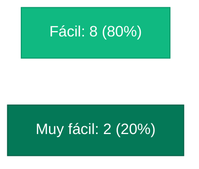

| Respuesta | Cantidad | Porcentaje |
|:---|:---:|:---:|
| **Fácil** | 8 / 10 | 80% |
| **Muy fácil** | 2 / 10 | 20% |

> [!NOTE]
> **Observación discreta del usuario:**
> **5 personas** comentaron que la carga en la app fue rápida y sencilla *una vez ya tenían descargados sus documentos*, pero que entrar a la banca en línea y descargarlos es el paso tedioso del proceso.

---

### 1.2 ¿Qué método de entrada utilizaste?

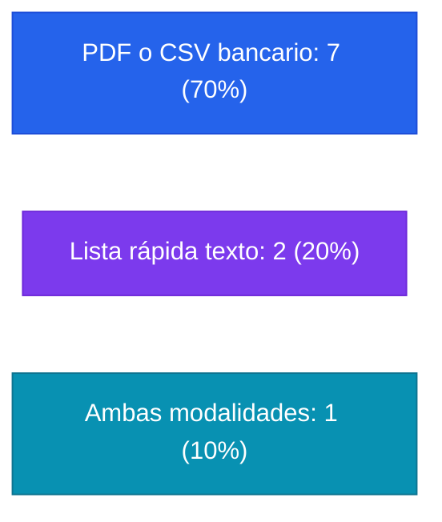

| Método | Cantidad | Porcentaje |
|:---|:---:|:---:|
| **PDF o CSV bancario** | 7 / 10 | 70% |
| **Copiar y pegar texto ("Lista rápida")** | 2 / 10 | 20% |
| **Ambas formas** | 1 / 10 | 10% |

> [!NOTE]
> **Observación discreta del usuario:**
> **2 personas** prefirieron no subir datos personales reales durante la prueba y optaron por explorar el flujo usando el archivo CSV de prueba brindado.

---

### 1.3 Conexión con correo electrónico para estados automáticos

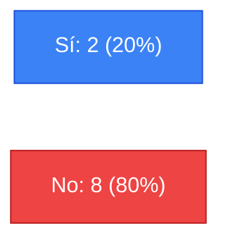

| Respuesta | Cantidad | Sentimiento Predominante |
|:---|:---:|:---|
| **Sí la utilizaría** | 2 / 10 (20%) | Uno de ellos fue quien propuso la funcionalidad previamente. |
| **No la utilizaría** | 8 / 10 (80%) | Preocupación unánime por pérdida de privacidad en su correo personal. |

> [!WARNING]
> **Insight de Privacidad:**
> Aunque la automatización reduce la fricción de descarga, el 80% de los usuarios no está dispuesto a entregar acceso a su bandeja de correo por desconfianza y privacidad. La arquitectura local sin credenciales externas está plenamente justificada.

---

### 1.4 Captura fotográfica de facturas

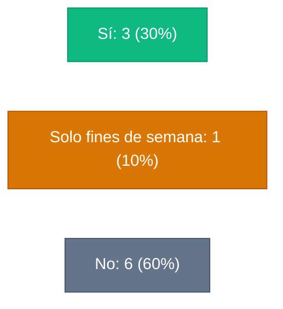

| Respuesta | Cantidad | Porcentaje |
|:---|:---:|:---:|
| **Sí (uso habitual)** | 3 / 10 | 30% |
| **Solo fines de semana** | 1 / 10 | 10% |
| **No** | 6 / 10 | 60% |

> [!NOTE]
> **Observación discreta del usuario:**
> La persona que respondió *"solamente fines de semana"* detalló que entre semana no suele pedir factura ni acumular recibos, pero durante el fin de semana se juntan muchas compras en comercios y es cuando surge la urgencia de registrarlas.

---

## 2. Dashboard Analítico de 4 Paneles

### 2.1 Claridad y utilidad general del Dashboard

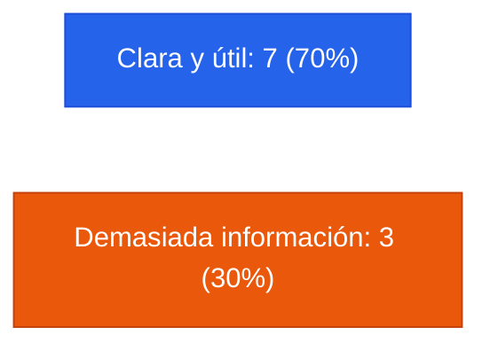

| Percepción | Cantidad | Porcentaje |
|:---|:---:|:---:|
| **Clara y útil** | 7 / 10 | 70% |
| **Demasiada información** | 3 / 10 | 30% |

> [!NOTE]
> **Observación discreta de UX:**
> **3 personas** sintieron sobrecarga cognitiva. Tener los 4 paneles abiertos de forma simultánea puede resultar abrumador para usuarios no familiarizados con gráficos financieros.

---

### 2.2 Panel: "¿A dónde va mi dinero?"

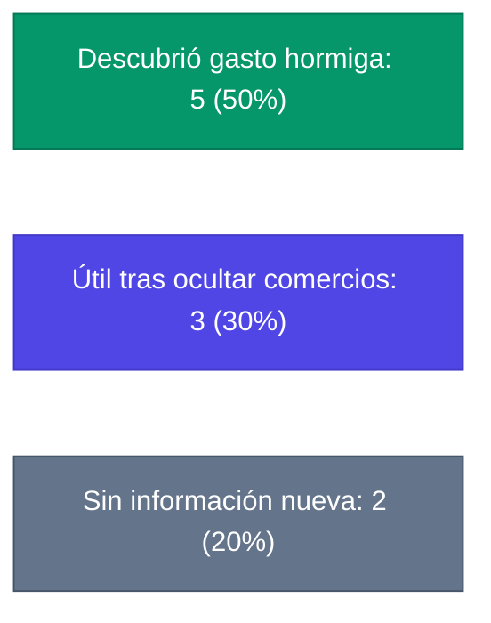

| Experiencia con el Panel | Cantidad | Porcentaje |
|:---|:---:|:---:|
| **Encontró gasto hormiga de inmediato** | 5 / 10 | 50% |
| **Útil, pero requirió ocultar compras fijas** | 3 / 10 | 30% |
| **Sin información nueva** | 2 / 10 | 20% |

> [!TIP]
> **Validación de Funcionalidad:**
> La interacción de descartar/ocultar comercios principales fue decisiva para que el **30% de los usuarios** pudiera desenterrar compras menores y gastos hormiga que estaban opacados por gastos fijos grandes como supermercados o combustible.

---

### 2.3 Panel: "Patrones de consumo"

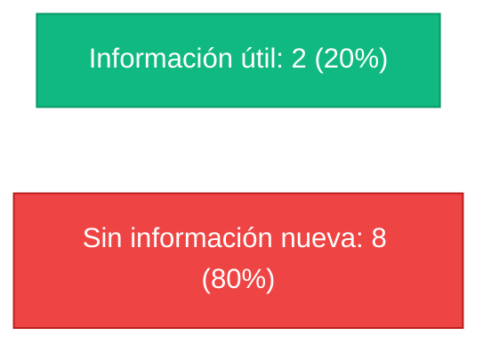

| Percepción | Cantidad | Porcentaje |
|:---|:---:|:---:|
| **Aportó información útil** | 2 / 10 | 20% |
| **No aportó información nueva** | 8 / 10 | 80% |

> [!NOTE]
> **Observación discreta del usuario:**
> La gran mayoría comentó que *"ya sabía de antemano que en fines de semana gasta más"*. Verlo en el gráfico confirmó su intuición pero no les aportó una guía clara de acción o beneficio nuevo.

---

### 2.4 Panel: "Antigüedad del gasto"

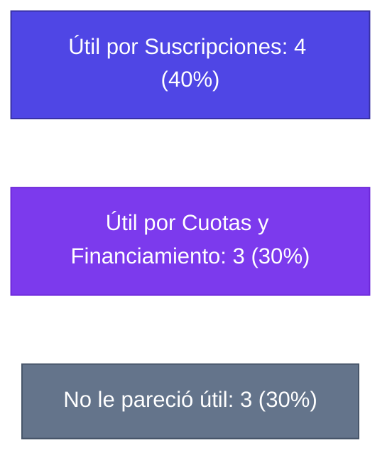

| Percepción | Cantidad | Porcentaje |
|:---|:---:|:---:|
| **Útil para controlar suscripciones** | 4 / 10 | 40% |
| **Útil para vigilar cuotas y extrafinanciamientos** | 3 / 10 | 30% |
| **No le pareció útil** | 3 / 10 | 30% |

> [!NOTE]
> **Observación emocional del usuario:**
> Dos personas con deudas en Visacuotas y extrafinanciamientos mostraron **preocupación y tensión visible** durante la entrevista: aunque conocían su deuda, confrontar la proporción acumulada que absorbe su quincena les causó incomodidad.

---

## 3. Módulo de Presupuestos y Gamificación

### 3.1 Creación Manual vs Generación Automatizada

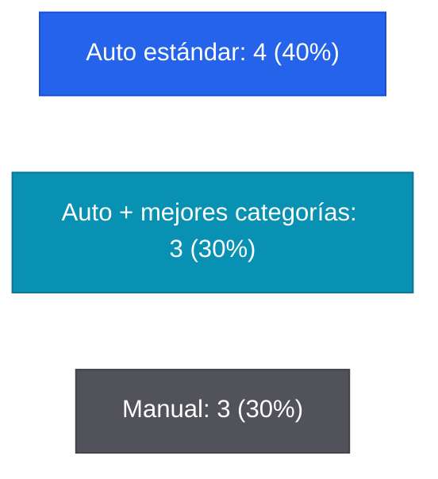

| Modalidad Preferida | Cantidad | Porcentaje |
|:---|:---:|:---:|
| **Generación automatizada directa** | 4 / 10 | 40% |
| **Automatizada, pero con categorías más precisas** | 3 / 10 | 30% |
| **Creación manual desde cero** | 3 / 10 | 30% |

> [!NOTE]
> **Oportunidad de Producto:**
> El **70% prefiere automatización**, pero el 30% enfatizó que las categorías sugeridas deben reflejar mejor los gastos cotidianos de Guatemala para evitar recategorizaciones manuales.

---

### 3.2 Indicador de "Dentro del Presupuesto"

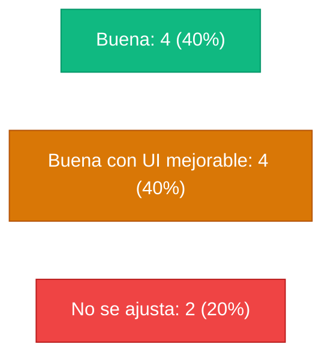

| Evaluación de la Herramienta | Cantidad | Porcentaje |
|:---|:---:|:---:|
| **Buena y clara** | 4 / 10 | 40% |
| **Buena, pero la interfaz visual debe pulirse** | 4 / 10 | 40% |
| **No se ajusta a sus necesidades** | 2 / 10 | 20% |

> [!NOTE]
> **Observación discreta del usuario:**
> Un usuario indicó que le causaría estrés ver el semáforo en rojo o el presupuesto casi consumido rápidamente, pues concentra la mayor parte de sus compras y pagos fijos en la **primera semana del mes**.

---

### 3.3 Gamificación y Rachas Semanales

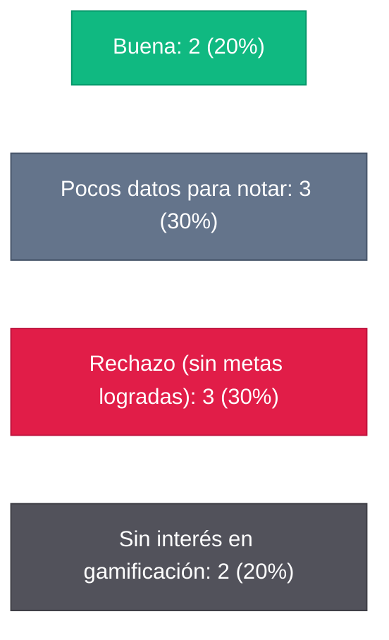

| Percepción de Gamificación | Cantidad | Porcentaje |
|:---|:---:|:---:|
| **Le pareció motivadora y buena** | 2 / 10 | 20% |
| **No cargó suficientes meses para apreciarla** | 3 / 10 | 30% |
| **No le gustó por falta de metas alcanzadas (frustración)** | 3 / 10 | 30% |
| **No le interesa la gamificación en aplicaciones** | 2 / 10 | 20% |

> [!WARNING]
> **Riesgo de Percepción Negativa:**
> La gamificación tuvo un efecto contraproducente en usuarios en déficit: al no tener metas logradas, los contadores vacíos generaron sensación de frustración y juicio negativo en lugar de motivación.

---

## 4. Decisión Final de Retención y Barreras Emocionales

### 4.1 ¿Continuaría utilizando esta aplicación? (N=10)

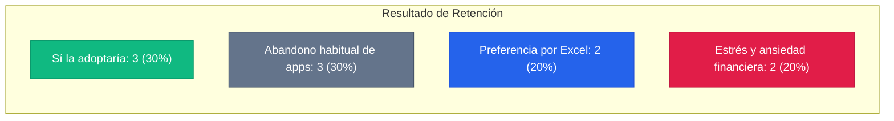

| Disposición de Uso | Cantidad | Porcentaje | Perfil de Usuario |
|:---|:---:|:---:|:---|
| **Sí continuaría usándola** | 3 / 10 | 30% | Usuarios convencidos por la velocidad de visualización y el análisis de gastos. |
| **No: suele abandonar apps financieras** | 3 / 10 | 30% | Historial de abandono por fatiga o falta de disciplina constante. |
| **No: prefiere su propio Excel** | 2 / 10 | 20% | Usuarios altamente estructurados con plantillas personales consolidadas. |
| **No: le genera estrés o ansiedad** | 2 / 10 | 20% | Personas con deudas que evitan confrontar sus estados de cuenta por angustia. |

---

## 5. Síntesis Estratégica para el Producto

1. **El competidor real es Excel, no otra app de finanzas:**  
   Los usuarios con disciplina financiera consolidada ya cuentan con hojas de cálculo hechas a su medida. Solo adoptarán la herramienta si el proceso de importación y extracción local les ahorra el trabajo manual de digitación.
2. **La barrera psicológica de la evasión y la ansiedad financiera:**  
   Varios entrevistados expresaron ansiedad vinculada al dinero: confrontar sus deudas o el impacto de la inflación les genera culpa y angustia (*"dejé de usar una app porque todo subía de precio, subían mis gastos y mi sueldo no sube"*). La aplicación debe comunicar empatía y alivio, evitando señales visuales excesivamente alarmistas o juicios punitivos.
3. **Privacidad como valor irrenunciable:**  
   El rechazo del 80% a la conexión con correo electrónico confirma que la arquitectura Split-Brain y el procesamiento 100% local en el navegador representan una ventaja competitiva fundamental frente a servicios en la nube.

