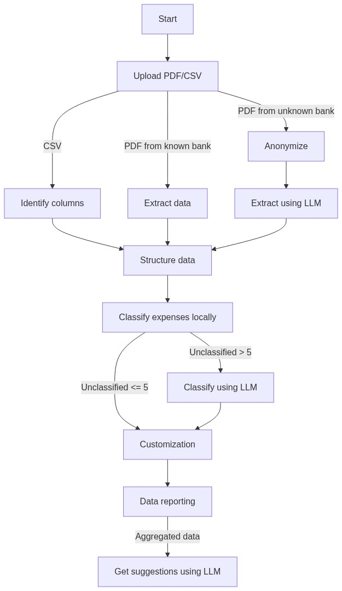

# La paradoja de sobredimensionar: por qué meter un LLM a todo es la nueva deuda técnica

*Antes de la era de la inteligencia artificial, nuestro mayor problema era subestimar las tareas. Hoy corremos el riesgo opuesto: asumir que los problemas son tan complejos que terminamos delegándole a un modelo lo que un par de líneas de código resuelven en dos milisegundos.*

---

Durante años, uno de los tropiezos más clásicos y compartidos en la industria del software fue la **subestimación**. Todos pasamos por eso: calculas con optimismo que cierta funcionalidad tomará un par de días, te comprometes con una fecha, y dos semanas después sigues despierto a las dos de la mañana depurando casos borde con un café frío al lado.

Pero en la era de los modelos de lenguaje (LLM), estoy notando que comenzamos a sufrir el síntoma exactamente opuesto: **la sobreestimación de los problemas**.

Hoy vemos un desafío técnico, recordamos lo frustrante que solía ser resolverlo en el pasado, y el instinto  es saltar a la salida fácil: *"Esto se ve complicadísimo. Mejor conectémosle un LLM y que la IA se encargue de la magia"*.

Hace poco me enfrenté a este problema mientras diseñaba una aplicación para control de gastos personales. Mi idea era permitir que cualquier persona subiera su estado de cuenta bancario en PDF o un archivo CSV para clasificar sus consumos, vigilar suscripciones y recibir sugerencias para ahorrar dinero. 

Sobre el papel, dos partes del problema parecían muy desafiantes:
1. Parsear estados de cuenta bancarios en formato PDF.
2. Clasificar automáticamente cientos de compras con descripciones comerciales crípticas.

Mi experiencia como desarrollador inicialmente me hizo pensar: *"Resolver esto con código tradicional va a ser tardado. Es el trabajo perfecto para un LLM"*.

Terminé diseñando una arquitectura híbrida sofisticada, con anonimización local y llamadas a la nube. Pero una vez que me senté a trabajar con código y resolver el problema real, me llevé una sorpresa incómoda: **el problema era ridículamente más simple de lo que creía**. El uso del LLM no solo era innecesario, sino que introducía latencia, costos y complejidad que nadie había pedido.

---

## El trauma del pasado: por qué le teníamos tanto miedo al PDF

Para entender por qué caí en la trampa de querer usar IA, hay que recordar el trauma colectivo que la ingeniería arrastra con los archivos PDF.

Un documento PDF no es un archivo de datos estructurados; es, en esencia, un conjunto de instrucciones gráficas que le dicen a un visor dónde dibujar líneas, curvas y glifos. No tiene el concepto nativo de "párrafo", ni de "tabla", ni de "columna". En los años 2010, intentar extraer transacciones de un PDF bancario era el combustible de las peores pesadillas de un desarrollador:

* **Tablas que no son tablas**: Si el estado de cuenta tiene dos columnas, la mayoría de los extractores de texto leen horizontalmente de izquierda a derecha, mezclando la fecha de la columna izquierda con el saldo de la derecha.
* **Coordenadas y layouts cambiantes**: Un pequeño ajuste de margen por parte del banco rompía cualquier parser basado en coordenadas visuales.
* **Basura tipográfica**: Espacios no separables, caracteres invisibles, códigos de control y saltos de línea arbitrarios en medio de una descripción.

A eso se sumaba la pesadilla de **clasificar los gastos**. Las descripciones que emiten los puntos de venta muchas veces están formados por palabras mal recortadas:

```text
POS 0912481 LA TORRE Z10 AUT008312 Q145.50
ESTAC CENTRAL PLAZA GT Q15.00
DB/SERV ELEC EEGSA 0912384 Q320.10
```

Con esas cicatrices frescas en la memoria, resulta tentador pensar en un prompt bien afinado para resolverlo todo sin esfuerzo.

---

## La arquitectura Split-Brain que implementé

En un tech demo anterior aprendí, e implementé de forma apropiada, la arquitectura Split-Brain. Como todo funcionó bien en esa ocasión, decidí aprovecharla de nuevo.

Como no quería violar la privacidad del usuario enviando estados de cuenta bancarios con nombres, cuentas bancarias y direcciones a los servidores de OpenAI o Google, aquí entra en juego Split-Brain.

La premisa era simple: todo lo que fuera privacidad y procesamiento determinista debía quedarse en local (en el navegador o en un servidor interno). Solo si el estado de cuenta venía de un banco desconocido o si quedaban demasiados gastos sin clasificar, invocaríamos a Google Gemini Pro tras haber censurado toda la información personal con expresiones regulares.

El flujo que decidí implementar fue el siguiente:



En papel y en código funciona, pero terminé dándome cuenta que se podía simplificar mucho el trabajo.

---

## La navaja de Ockham: cuando la solución aburrida gana por mucho

Mientras programaba el parser para el banco de prueba, me di cuenta de algo evidente:

### 1. Construir un parser por banco es sorprendentemente fácil (actualmente)
Un estado de cuenta bancario no cambia de formato todos los meses. Los bancos son instituciones conservadoras; su diseño suele mantenerse intacto durante años. 

Con un extractor de texto plano como `pdf-parse` y un puñado de expresiones regulares bien escritas, pude:
* Identificar el banco con dos palabras clave del encabezado.
* Aislar la sección de movimientos y descartar páginas de publicidad o resúmenes de saldo.
* Extraer fecha, descripción del comercio y monto debitado en cuestión de 4 milisegundos.
* Filtrar pagos de tarjeta, abonos y cobros en dólares sin riesgo de alucinaciones.

¿Cuánto me tomó escribir ese parser determinista? Minutos gracias a un prompt bien hecho. ¿Cuánto cuesta ejecutarlo? Cero dólares. ¿Cuánta latencia introduce? No llega ni a un segundo. 

### 2. Clasificar gastos locales no requiere Deep Learning
Pensé que clasificar comercios iba a exigir un modelo de clasificación semántica. Pero cuando te sientas a mirar los consumos reales de una persona entiendes algo: Si conoces bien a tu público objetivo, puedes hacer un listado que cubra fácilmente el 90% de sus consumos.

Algunos supermercados, gasolineras, empresas de agua y electricidad, unos cuántos proveedores de comida rápida y allí cubrimos la myoría. Donde encontramos más variedad es en comida rápida y en algunos negocios locales donde el POS tiene el nombre del vendedor.

Un simple archivo JSON de algunos cientos de líneas (`merchant-catalog.json`) con palabras clave y normalización de texto (quitando tildes y caracteres especiales) clasificó más del 90% de las transacciones al instante:

```typescript
// Si la descripción contiene "la torre" o "paiz" -> Supermercado
// Si contiene "shell" o "uno" -> Transporte y Combustible
// Si contiene "netflix" o "spotify" -> Suscripciones
```

Sin llamadas de red. Sin tokens. Sin riesgo de que la API de la nube esté caída o devuelva un JSON malformado.

### 3. Las recomendaciones de ahorro tampoco necesitaban un LLM
Al inicio me entusiasmé con la idea de que Gemini analizara el gasto consolidado y diera "consejos financieros personalizados". Pero al evaluar las respuestas que devolvía, eran exactamente las mismas reglas de sentido común que cualquier aplicación financiera tradicional implementa con lógica condicional:
* *"Tus suscripciones suman más de Q 350 al mes; revisa si estás usando todas."*
* *"El gasto en restaurantes representa el 40% de tu presupuesto; cocinar más en casa podría ahorrarte Q 500 mensuales."*

Todo eso se puede calcular con simples umbrales porcentuales. 

De pronto me encontré frente a mi propia arquitectura y tuve que admitirlo: **había creado un sistema con LLM para un problema que nunca necesitó un LLM.**

---

## Lo que me llevo de esta experiencia

Estamos viviendo una etapa dorada para el desarrollo de software. Los modelos de lenguaje y las herramientas modernas nos permiten construir a una velocidad impensable hace solo unos años.

Pero esa misma facilidad puede nublar nuestro juicio arquitectónico:

1. **No cambies la complejidad del dominio por complejidad de infraestructura:** Si un problema se resuelve con un parser de 100 líneas o una lista de búsqueda en memoria, no le sumes una dependencia de red, un modelo estocástico, costos de tokens y políticas de reintento solo porque "la IA está de moda".
2. **Cuidado con la sobreestimación:** Antes le teníamos miedo a problemas difíciles y los subestimábamos. Hoy asumimos que cualquier problema con datos desestructurados requiere magia generativa. La mayoría de las veces, un poco de lógica determinista y sentido común resuelven el 90% del caso de uso.
3. **La IA ejecuta, pero el criterio sigue siendo tuyo:** Un modelo o agente construirá con gusto cualquier solución que le pidas, por más sobrediseñada que sea. Decidir qué **no** construir, qué **no** delegar a un modelo externo y mantener la simplicidad sigue siendo la responsabilidad irremplazable del ingeniero.

Al final, la mejor arquitectura no es la que usa la tecnología más sofisticada para resolver un problema, sino la que tiene la madurez de dejar de lado la herramienta de moda cuando un script sencillo y predecible hace el trabajo cien veces mejor.
