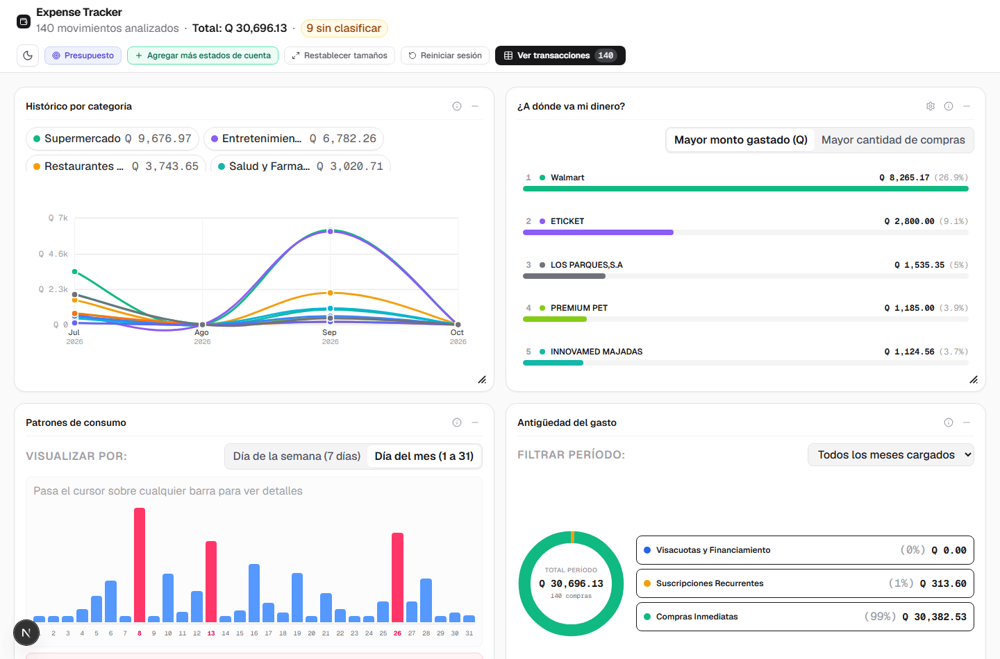
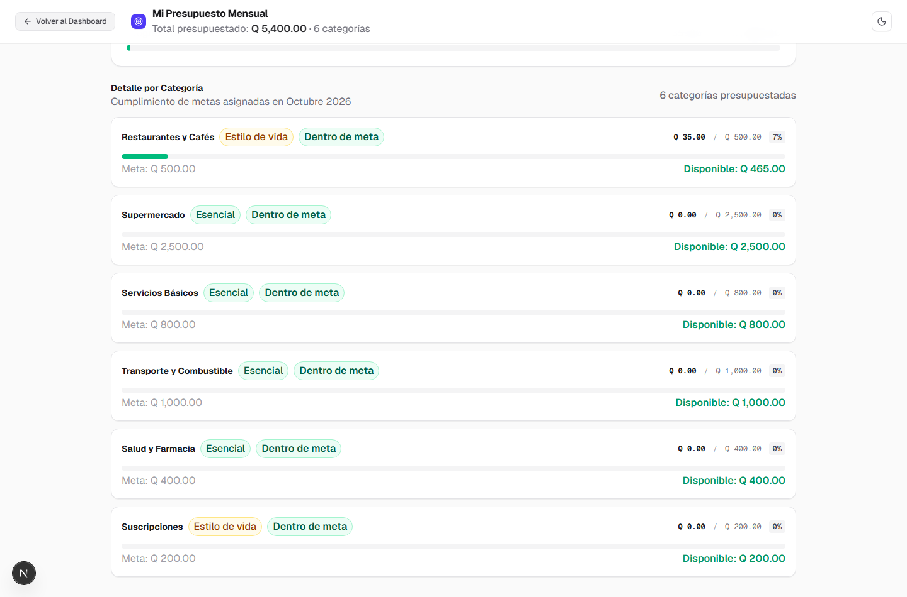
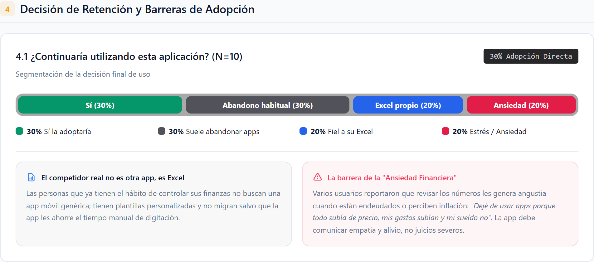

# La ilusión del Expense Tracker: cuando tu verdadero competidor es Excel y tu mayor obstáculo es la ansiedad humana

*Cómo cuatro iteraciones de producto nos enseñaron que añadir más funcionalidades no resuelve la fricción psicológica de las finanzas personales en tiempos de incertidumbre económica.*

---

Existe una trampa clásica en la que casi todo desarrollador o creador de producto cae al menos una vez en su carrera: **creer que si los usuarios no adoptan tu solución, es simplemente porque le falta una funcionalidad más**.

Asumimos que si diseñamos una interfaz más limpia, si añadimos gráficos más coloridos o si programamos un asistente de presupuestos con gamificación, la gente finalmente sentirá la motivación necesaria para ordenar sus finanzas.

Hace algunas semanas comenzamos a construir **Expense Tracker**, una aplicación web diseñada para ayudar a las personas a tomar el control de su dinero a través de sus estados de cuenta bancarios. Queríamos resolver un problema cotidiano que millones de personas enfrentan a fin de mes: *"¿A dónde diablos se fue mi dinero?"*.

El resultado técnico fue un éxito: una arquitectura rápida, respetuosa de la privacidad local del usuario y repleta de herramientas analíticas. Sin embargo, al poner la aplicación frente a usuarios reales en una serie de entrevistas a profundidad, el producto nos devolvió una lección de humildad brutal.

Descubrimos dos verdades incómodas que rara vez se discuten en los tutoriales de producto:
1. **Nuestro principal competidor nunca fue otra app de la tienda; era Microsoft Excel.**
2. **En tiempos de incertidumbre económica e inflación, una aplicación de finanzas puede provocar más estrés que alivio.**

Esta es la historia de cómo cuatro iteraciones de desarrollo nos obligaron a mirar más allá del código para comprender la compleja psicología del dinero.

---

## El inicio: de la ingesta básica a la visualización analítica

En la primera etapa del proyecto nos concentramos en lo elemental: lograr que la aplicación pudiera leer estados de cuenta bancarios en PDF y clasificar gastos de forma determinista y privada, sin enviar datos confidenciales a servidores externos.

Una vez que la base técnica estuvo resuelta, la **segunda iteración** se enfocó por completo en la experiencia del usuario: **¿cómo presentar los datos para que aportaran valor real y no solo números fríos?**

No queríamos limitarnos a una lista aburrida de transacciones. Diseñamos un tablero visual interactivo compuesto por cuatro paneles analíticos:

1. **"¿A dónde va mi dinero?"**: Identificación de los comercios con mayor concentración de gasto y frecuencia de compra, permitiendo ocultar compras obvias (como el supermercado) para desenterrar consumos secundarios.
2. **"Patrones de consumo"**: Desglose del gasto por días de la semana frente a días del mes.
3. **"Antigüedad del gasto"**: Separación clara entre gastos corrientes del mes, compras financiadas en cuotas y suscripciones recurrentes.
4. **Histórico y tendencias**: Evolución temporal por categorías de consumo.

Sobre la pantalla, el producto se veía potente y profesional. Calculaba totales precisos en Quetzales (Q), detectaba pagos de servicios, suscripciones ocultas y compras a plazos.

Pero cuando los primeros usuarios reales intentaron usarlo en su día a día, apareció la primera gran muralla.

---

## El primer obstáculo: la pesada fricción de los estados de cuenta

Para que un panel analítico brille, necesita datos. Y la forma en que habíamos diseñado la entrada de datos exigía un flujo que en nuestra cabeza parecía trivial, pero en la realidad era un calvario de fricción:

1. El usuario debía recordar ingresar al portal web de su banca en línea o buscar en su correo electrónico el estado de cuenta mensual.
2. Superar tokens de seguridad, contraseñas temporales y páginas bancarias lentas.
3. Descargar el archivo PDF o CSV a su computadora.
4. Entrar a nuestra aplicación y arrastrar el archivo.

Ese recorrido era suficiente para que la mayoría de los usuarios postergara la tarea indefinidamente. 

Pensamos de inmediato en la solución técnica obvia: *"Conectemos la aplicación a la cuenta de Gmail del usuario para que busque automáticamente los estados de cuenta que el banco le envía cada mes"*. 

La idea sonaba brillante hasta que se la propusimos a los usuarios: **el 80% la rechazó de forma tajante**. Nadie quería concederle acceso a su bandeja de correo personal a una aplicación de finanzas por temor a perder su privacidad. La conveniencia técnica no podía ganarle al recelo sobre la privacidad.

---

## La trampa de las iteraciones 3 y 4: "Si construimos más, vendrán"

Frente a la resistencia para subir estados de cuenta bancarios, cometimos el error clásico: pensar que el problema era de incentivos funcionales. Nos dijimos: *"Si les damos herramientas financieras más avanzadas, el valor percibido será tan alto que no les importará la molestia de descargar el PDF"*.

Durante la **tercera y cuarta iteración**, nos volcamos a expandir el producto:

* **Soporte masivo de bancos:** Desarrollamos parsers específicos para tarjetas de crédito de las principales instituciones financieras del país (Banco Industrial, BAC Credomatic, Banco G&T Continental, Cuscatlán, FICOHSA y Banco Agromercantil).
* **Ingreso rápido en texto:** Para quienes no querían lidiar con un PDF, habilitamos un modal de notas rápidas donde bastaba con pegar un listado informal como `Cine 98`, `Gasolina 150`, `Almuerzo 45`.
* **Herramienta completa de presupuestos:** Desarrollamos un generador de presupuestos inteligente capaz de calcular metas mensuales sugeridas a partir del promedio histórico de consumos, complementado con semáforos de cumplimiento, indicadores de saldo disponible, sugerencias personalizadas para el siguiente mes y gamificación basada en rachas de semanas bajo control.

Teníamos una plataforma completa: lectura bancaria de múltiples entidades, análisis de tendencias, presupuestos automatizados y seguimiento de metas.

Había llegado el momento de la verdad: someter la aplicación a una evaluación rigurosa con usuarios reales de distintos perfiles económicos.

---

## El choque con la realidad: los resultados de la encuesta

Realizamos una ronda de pruebas guiadas y entrevistas a profundidad con 10 usuarios potenciales, evaluando usabilidad, valor práctico y disposición real de retención mensual.

Los números de usabilidad fueron sobresalientes: el 100% de los participantes calificó la carga de archivos como fácil o muy fácil una vez tenían el documento a mano, y el 70% elogió la claridad visual del tablero y la utilidad del generador automático de presupuestos.

Sin embargo, cuando llegamos a la pregunta definitiva: **"¿Continuaría utilizando esta aplicación en su rutina mensual?"**, los resultados mostraron una fractura contundente:

Solo un **30% de los encuestados mostró una intención real de adopción continua**. 

El 70% restante no abandonaba por fallos de interfaz ni por bugs en el código. Al indagar en los motivos del rechazo, descubrimos una segmentación de usuarios que ninguna métrica de Google Analytics suele reflejar:

### 1. Para los usuarios disciplinados, el rival es Excel (20%)
Un grupo significativo de entrevistados ya llevaba un control estricto de su dinero. Pero cuando les mostramos nuestra aplicación, su respuesta unánime fue: *"Prefiero mi Excel"*.

Las personas que tienen el hábito arraigado de registrar sus gastos no quieren una aplicación prediseñada. Llevan años afinando su propia plantilla en Excel o Google Sheets, con columnas que responden a sus manías exactas, fórmulas a la medida y la flexibilidad absoluta de modificar cualquier celda sin depender del criterio de un programador ajeno.

Competir contra otra app de finanzas es una batalla de diseño y marketing; **competir contra el archivo de Excel que un usuario ordenado perfeccionó durante tres años es una batalla perdida de antemano**, a menos que tu herramienta se dedique exclusivamente a facilitarle la vida a esa hoja de cálculo.

### 2. Para quienes no llevan control, el obstáculo es la ansiedad financiera (20%)
Al investigar a los usuarios que no llevaban ningún registro y que rechazaron la aplicación, esperábamos encontrar simple desinterés o falta de tiempo. La realidad fue mucho más profunda y dolorosa: **confrontar sus números les causaba estrés directo**.

En un entorno marcado por la inflación, el encarecimiento de la canasta básica y deudas acumuladas en tarjetas de crédito o extrafinanciamientos, abrir un tablero financiero no se siente como un acto de empoderamiento, sino como un interrogatorio punitivo:

> *"Dejé de usar aplicaciones de presupuesto porque todo subía de precio: subían mis gastos, subían los intereses y mi sueldo no subía. Ver los números todos los días solo me daba angustia."*

Al probar nuestra herramienta, usuarios con deudas activas se sintieron abrumados al ver gráficamente qué porcentaje de sus ingresos era devorado por cuotas arrastradas de compras pasadas. Para ellos, los semáforos en rojo y las metas incumplidas no funcionaban como un llamado a la acción; funcionaban como una confirmación gráfica de fracaso personal que preferían evadir.

Paradójicamente, **las personas que más se beneficiarían de una herramienta de control de gastos son las más propensas a abandonarla por agotamiento emocional**.

### 3. El abandono por hábito y la indiferencia económica (30%)
El último segmento agrupaba a quienes descargan sistemáticamente aplicaciones de productividad para dejarlas en el olvido dos semanas después por pura fatiga de registro, junto con usuarios que sencillamente no sentían urgencia por ordenar sus consumos: algunos porque disfrutaban de ingresos holgados sin restricciones, y otros porque el pesimismo sobre el panorama económico global los llevaba a una mentalidad de *"¿para qué me voy a privar de salir a comer hoy si de todos modos no me va a alcanzar para comprar una casa?"*.

---

## Lecciones aprendidas: lo que el código no te enseña

Este proceso de cuatro iteraciones nos dejó tres aprendizajes fundamentales para cualquier persona construyendo productos de software hoy en día:

### 1. Identifica a tu competidor real
Tu competidor rara vez es la aplicación que se parece a la tuya en Product Hunt. Tu competidor suele ser la herramienta todoterreno más flexible del planeta (Excel, una libreta de notas, WhatsApp consigo mismo) o la inercia psicológica de no querer saber. 

Si los usuarios más disciplinados prefieren su hoja de cálculo, tal vez el camino no sea obligarlos a entrar a una plataforma cerrada, sino construir el mejor extractor y normalizador de datos bancarios para que alimenten su Excel en segundos.

### 2. Segmenta a tus usuarios por psicología, no por demografía
Antes de escribir una sola línea de código, hazte estas preguntas:
* **¿Quién tiene ya resuelto este problema?** ¿Qué herramienta utiliza y realmente tenemos argumentos para competir contra ella?
* **¿Por qué quienes no lo resuelven evitan hacerlo?** ¿Es realmente por falta de herramientas, o es porque la solución les produce culpa, estrés o indiferencia?

Una interfaz para alguien con deudas no puede usar los mismos estímulos que una para alguien con superávit de ahorro. Los semáforos alarmistas, las campanas de notificación de sobregasto y las insignias de gamificación vacías terminan castigando al usuario vulnerable en lugar de acompañarlo.

### 3. El superpoder del desarrollo asistido por IA para micro-nichos
Al mirar los resultados fríos, uno podría pensar que el mercado para un nuevo Expense Tracker es demasiado pequeño para justificar su existencia. Y en el modelo tradicional de desarrollo de software, donde se necesitaban meses de trabajo y presupuestos considerables para levantar un MVP, esa conclusión habría sido el fin del proyecto.

Sin embargo, el desarrollo asistido por herramientas modernas de IA cambia radicalmente la ecuación económica. Hoy podemos construir, refinar parsers bancarios complejos, diseñar interfaces interactivas y poner prototipos funcionales a prueba en cuestión de semanas o días.

Esto significa que ya no necesitamos capturar mercados masivos de millones de personas para que un producto tenga sentido. Podemos crear herramientas hiperenfocadas en nichos pequeños y específicos —por ejemplo, profesionales que quieren convertir sus estados de cuenta de bancos locales directamente a formatos listos para su Excel personal sin tocar la nube— con una eficiencia de desarrollo que hace pocos años era sencillamente impensable.

---

## Reflexión final

Construir software no se trata únicamente de elegir la arquitectura adecuada, escribir parsers limpios o renderizar gráficos interactivos con latencia cero. Todo eso es el andamiaje técnico.

El verdadero desafío de diseñar productos radica en entender las emociones, las culpas y las rutinas silenciosas de las personas que estarán al otro lado de la pantalla. En el terreno del dinero, el éxito de una herramienta no se mide por la cantidad de paneles que despliega, sino por su capacidad de ofrecer claridad sin juicio y control sin ansiedad.