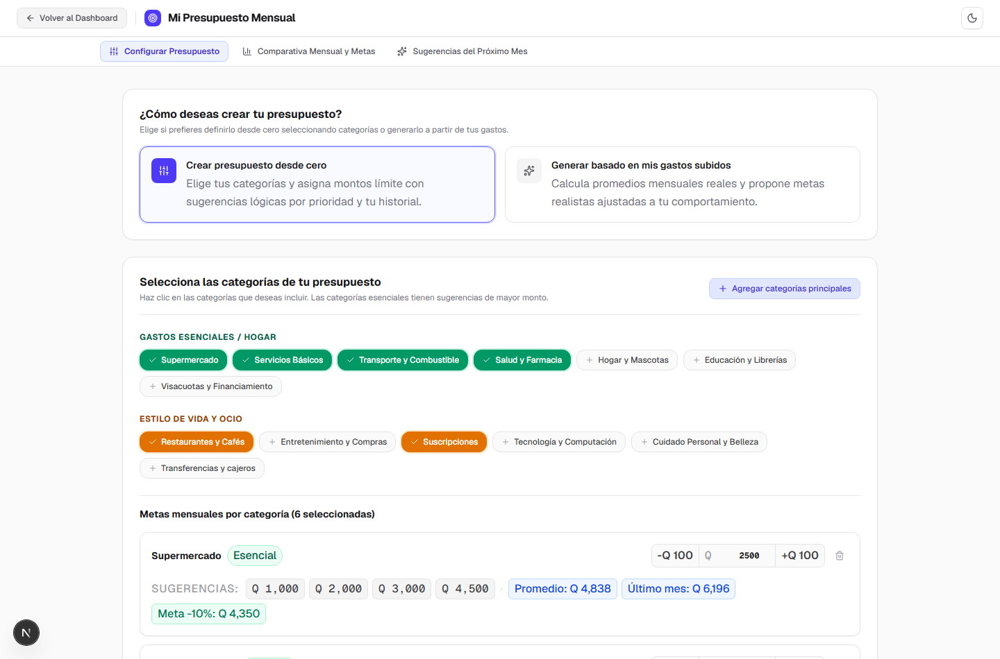
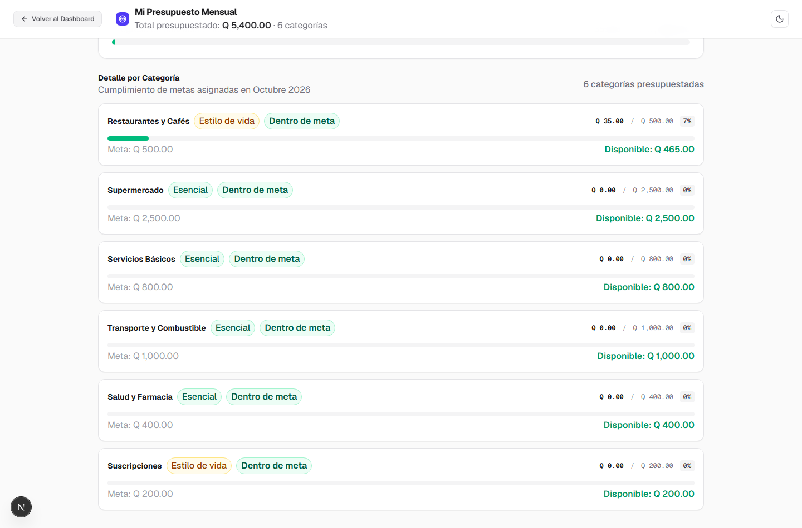
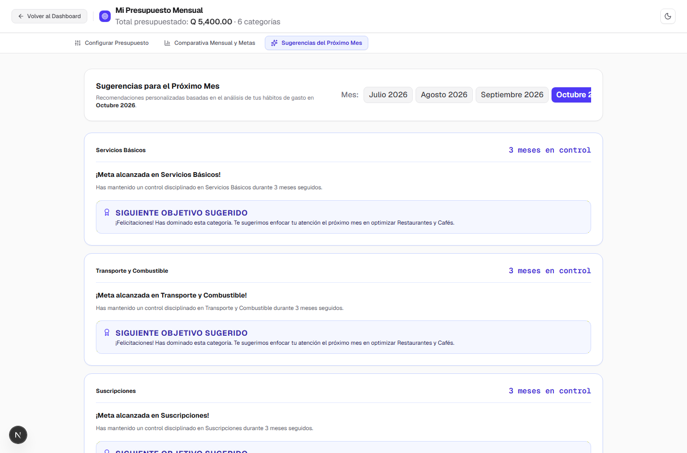

# Implementación del Módulo de Presupuestos (Budgeting Tool)
## US-054 a US-063 — Reporte de Integración y Calidad

**Rama de trabajo:** `feature/budget-tool`  
**Estado:** Completado y Verificado al 100%  
**Fecha:** Octubre 2026  

---

## 1. Resumen Ejecutivo y Arquitectura

Se ha implementado el módulo completo de Presupuestos Personales (**Personal Expense Tracker Budgeting Tool**), permitiendo a los usuarios planificar, monitorear y optimizar sus finanzas personales con soporte multi-mes, análisis de causas raíz y sugerencias proactivas.

### Principios de Arquitectura Cumplidos
- **Arquitectura Split-Brain (100% Local):** Todo el motor de cálculo presupuestario, diagnóstico de causas raíz, tendencias históricas y gamificación (`src/lib/budget-engine.ts`) corre de forma puramente determinista en TypeScript local, sin enviar datos financieros ni sensibles a LLMs externos.
- **Persistencia y Resiliencia en `localStorage`:** Los presupuestos se almacenan bajo la clave `expense_tracker_budget_v1`. El sistema detecta y limpia datos corruptos de forma transparente (`loadStoredBudgetState`, `saveStoredBudgetState`, `clearStoredBudgetState`).
- **Control de Versiones Históricas:** Soporte de presupuestos históricos y versiones vigentes a partir de meses específicos (`effectiveFromMonth`), resolviendo con exactitud el presupuesto aplicable a cualquier mes pasado o futuro (`getBudgetForMonth`).
- **Reglas de Estilo e Identidad Visual (AGENTS.md):**
  - **100% en Español:** Textos, etiquetas, alertas, diagnósticos y sugerencias de mejora.
  - **Moneda Quetzales (GTQ / Q):** Todos los montos se muestran formateados en Quetzales.
  - **Cero Emojis:** Todos los elementos gráficos e indicadores utilizan iconos vectoriales SVG estándar (`src/components/icons.tsx`).
  - **Limpieza de Interfaz:** Sin badges ni etiquetas pseudo-técnicas; la cabecera únicamente muestra instituciones bancarias verificadas.

---

## 2. Galería Visual del Módulo de Presupuestos

| Configurador Interactivo y Presets por Niveles | Comparativa Real vs. Presupuestado y Rachas |
| :---: | :---: |
|  |  |

| Diagnósticos de Causa Raíz y Sugerencias de Mejora |
| :---: |
|  |

---

## 3. Detalle de Historias de Usuario Implementadas

| Historia | Título | Commit | Estado |
| :--- | :--- | :--- | :---: |
| **US-054** | Budget Data Structures, Versioning & LocalStorage Persistence | `fc50fdb` | Concluido |
| **US-055** | Dedicated Budgeting Tool View & Cross-Screen Navigation | `e7950d9` | Concluido |
| **US-056** | Interactive Budget Builder from Zero with Tiered Category Presets | `e08a5c5` | Concluido |
| **US-057** | Realistic Budget Generator from Historical Transactions | `2ece664` | Concluido |
| **US-058** | Budget Editing Workflow & Historical Application Scope Modal | `5e569d7` | Concluido |
| **US-059** | Monthly Budget vs Actual Comparison Engine & View | `061a78f` | Concluido |
| **US-060** | Gamified Weekly Streaks and Goal Counters | `5dce558` | Concluido |
| **US-061** | Root-Cause Analyzer and Multi-Month Coaching Engine | `91c442d` | Concluido |
| **US-062** | Next-Month Improvement Suggestions UI & Actionable Insights Panel | `107c9dd` | Concluido |
| **US-063** | End-to-End Budgeting Integration, Localization & Regression QA | `fcb7e14` | Concluido |

---

### Resumen Técnico por Historia

#### US-054: Estructuras de Datos y Persistencia
- **Modelos:** Tipos canónicos definidos en `src/types/budget.ts` (`CategoryBudget`, `MonthlyBudgetVersion`, `StoredBudgetState`, `BudgetComparison`, `GamifiedFunStats`, `NextMonthSuggestion`).
- **Almacenamiento:** Módulo `src/lib/storage.ts` ampliado con funciones de guardado, carga, limpieza y resolución temporal (`getBudgetForMonth`).
- **Pruebas:** 4 pruebas unitarias en `src/lib/storage.test.ts` verificando persistencia, tolerancia a fallos/JSON corrupto y resolución multi-versión.

#### US-055: Vista Dedicada y Navegación Bidireccional
- **Componentes:** `src/components/budget-tool-view.tsx` y enlaces integrados en el Landing (`#btn-open-budget-landing`) y en el Dashboard Header (`#btn-dashboard-open-budget`).
- **Navegación Fluida:** El botón `#btn-budget-back` permite alternar entre el dashboard o la pantalla de carga sin pérdida de estado ni recargas innecesarias.

#### US-056: Creador Interactivo de Presupuestos desde Cero
- **Presets por Niveles:** Botones de adición rápida ("Categorías principales" `+Q 3,400`, "Esenciales" `+Q 3,900`, "Todas las categorías").
- **Ajustes Rápidos:** Botones de micro-ajuste (`+Q 50`, `+Q 100`, `-Q 50`, `-Q 100`) e inputs numéricos con validación en tiempo real.
- **Contexto Histórico:** Cuando existen transacciones cargadas, muestra chips contextuales con el promedio de gasto histórico de cada categoría.

#### US-057: Generador de Presupuestos Realistas desde Transacciones
- **Motor Estadístico:** Algoritmo de optimización que calcula metas alcanzables:
  - Categorías esenciales: Meta al 95% del promedio histórico.
  - Categorías no esenciales: Meta al 85% del promedio histórico.
  - Redondeo inteligente a montos limpios en Quetzales (múltiplos de Q 5, Q 10 o Q 25).
- **Control de Metas:** Vista previa interactiva con opción de incluir/excluir categorías y guardar directamente.

#### US-058: Flujo de Edición y Modal de Alcance Histórico
- **Edición en Caliente:** Botón `#btn-edit-budget-overview` para modificar límites activos.
- **Modal de Confirmación de Alcance:** Al guardar cambios existiendo datos históricos, consulta al usuario:
  - *"Aplicar a meses anteriores y de ahora en adelante"* (`all_months`).
  - *"Aplicar solo de ahora en adelante"* (`from_now_on`).
- **Preservación de Historial:** Las versiones de presupuestos de meses pasados se preservan intactas en `monthlyBudgets`.

#### US-059: Motor y Vista de Comparativa Mensual (Real vs Presupuestado)
- **Cálculo Determinista:** Función `compareMonthAgainstBudget` evalúa totales, gastos reales, ahorro neto o exceso, y porcentaje de utilización global y por categoría.
- **Barra de Selector de Meses:** Barra interactiva `#month-selector-bar` con píldoras de meses disponibles y etiqueta de versión de presupuesto.
- **Desglose de Categorías:** Semáforo de estados (`under` en verde, `near` en amarillo, `over` en rojo, `way_over` en rojo oscuro) con barras de progreso y aviso de categorías no presupuestadas.

#### US-060: Rachas Semanales Gamificadas y Contadores de Metas
- **Motor de Gamificación:** `calculateBudgetFunStats` computa:
  - Rachas de semanas consecutivas dentro del presupuesto (partición en 4 semanas de calendario por mes).
  - Categorías cumplidas vs totales del mes.
  - Mejor categoría del mes (mayor ahorro en Quetzales respecto al límite).
  - Meses históricos dentro del presupuesto.
- **Indicadores Visuales:** Tarjetas de estadísticas con iconos SVG (`Flame`, `Award`, `TrendingUp`, `CheckCircle2`).

#### US-061 y US-062: Diagnóstico de Causas Raíz y Panel de Sugerencias
- **Diagnóstico Automático (Regla 1):** Detecta la causa raíz de excesos presupuestarios:
  - `compra_unica_alta`: Un gasto individual representa ≥ 45% del total o supera el límite de la categoría.
  - `concentracion_fechas`: Los gastos se concentran en un rango estrecho de días (≤ 3 días).
  - `alta_frecuencia`: Frecuencia excesiva de transacciones pequeñas repetidas.
  - `monto_total_elevado`: Acumulación general de gastos a lo largo del mes.
- **Trayectoria Multi-Mes:**
  - *Regla 2 (1 a 2 meses excedidos):* Sugerencias de corrección a corto plazo.
  - *Regla 3 (3+ meses continuos):* Sugerencias de maestría o ajuste de límites cuando una meta fue alcanzada sostenidamente o pivotaje cuando el límite es irreal.
- **Panel de Sugerencias:** Pestaña dedicada con tarjetas diferenciadas por colores e iconos SVG según el nivel de alerta.

#### US-063: Integración End-to-End, Calidad y Regresión
- **Archivos de Prueba E2E:** `e2e/budget-tool.spec.ts` con 12 casos de prueba automatizados en Playwright.
- **Datos de Prueba:** Conjuntos de datos en `demo/` cubriendo múltiples meses (septiembre, octubre, noviembre 2026) y categorías normalizadas.
- **Ciclo Completo:** Verificación sin intervención humana de la carga rápida por texto, creación desde cero, generación realista, edición, persistencia y navegación.

---

## 4. Resultados de Pruebas y Verificación

### Pruebas Unitarias (`npm test`)
- **Total de Pruebas Ejecutadas:** 291
- **Suites:** 58
- **Pasadas:** 291 (100%)
- **Fallidas:** 0
- **Tiempo de Ejecución:** ~5.7s

### Verificación de Compilación (`npm run build`)
- **Compilador:** Next.js 16.4.3 (Turbopack) + TypeScript
- **Resultado:** Compilación estática y de rutas dinámicas 100% exitosa con 0 errores de tipos y 0 advertencias.

### Pruebas E2E Automatizadas (`npx playwright test e2e/budget-tool.spec.ts`)
- **Total de Pruebas E2E:** 12
- **Pasadas:** 12 (100%)
- **Navegadores:** Chromium
- **Tiempo Total:** 24.0s
- **Detalle de Pruebas Pasadas:**
  1. `persists budget state in window.localStorage across reloads` (1.1s)
  2. `recovers from corrupted budget storage` (0.8s)
  3. `US-055: opens budget tool from landing screen and returns seamlessly` (0.9s)
  4. `US-055: opens budget tool from dashboard header and preserves active session` (1.3s)
  5. `US-056: creates budget from zero using tiered category presets and quick actions` (1.3s)
  6. `US-056: displays historical context chips when transactions exist` (1.4s)
  7. `US-057: generates realistic budget from uploaded transactions with achievable targets` (1.4s)
  8. `US-058: allows editing active budget and prompts with historical scope confirmation modal` (1.4s)
  9. `US-059: renders month selector, monthly summary card, and category comparison with unbudgeted warning` (1.2s)
  10. `US-060: displays gamified budget performance stats (weekly streaks, category goal counts, best savings)` (1.1s)
  11. `US-061 & US-062: displays next-month improvement suggestions, root-cause diagnostics, and coaching panels` (1.1s)
  12. `US-063: verifies end-to-end integration across navigation, simple list ingestion, budget creation, and persistence` (1.8s)

---

## 5. Archivos Clave Creados o Modificados

- `src/types/budget.ts`: Definición de interfaces y tipos de presupuestos, metas, estadísticas y comparaciones.
- `src/lib/budget-engine.ts`: Motor determinista de cálculo presupuestario, generación de metas, diagnósticos de causa raíz y estadísticas.
- `src/lib/budget-engine.test.ts`: Pruebas unitarias completas del motor presupuestario (35 tests).
- `src/lib/storage.ts`: Persistencia y validación de `StoredBudgetState` en `localStorage`.
- `src/lib/storage.test.ts`: Pruebas unitarias de almacenamiento y autorreparación de presupuestos.
- `src/components/budget-tool-view.tsx`: Vista principal del módulo con pestañas de Comparativa, Sugerencias y Configuración.
- `src/components/dashboard-view.tsx`: Integración del botón de acceso al presupuesto en la cabecera del dashboard.
- `src/app/page.tsx`: Coordinación de navegación global y sincronización de estado de sesión y presupuesto.
- `e2e/budget-tool.spec.ts`: Suite completa de pruebas E2E en Playwright.
- `demo/budget-sample-multi-month.csv`: Archivo de muestra con datos multi-mes para pruebas y demostración.
- `USER_STORIES_4.md`: Historias de usuario US-054 a US-063 marcadas como completadas con sus criterios de aceptación.
