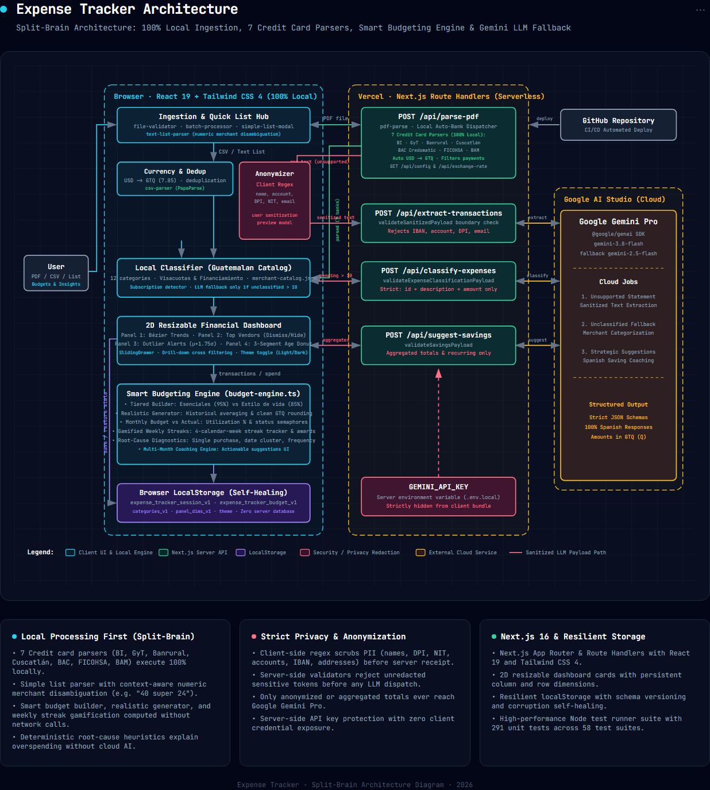
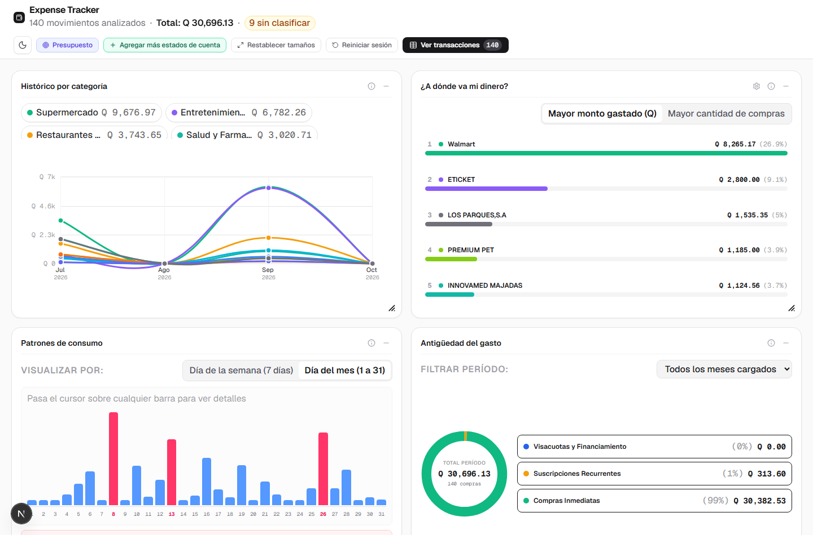
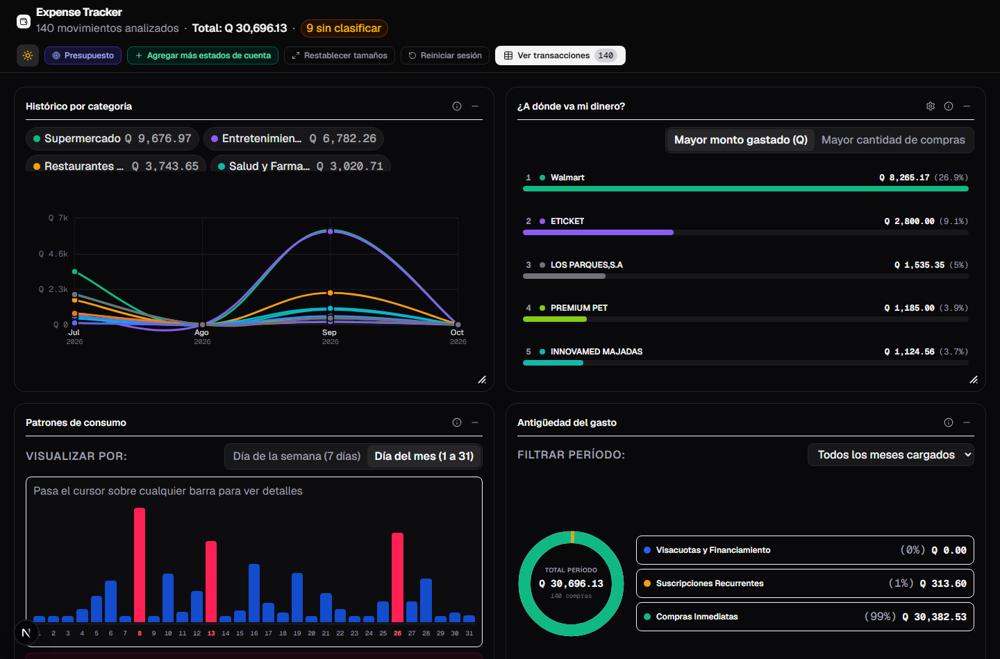
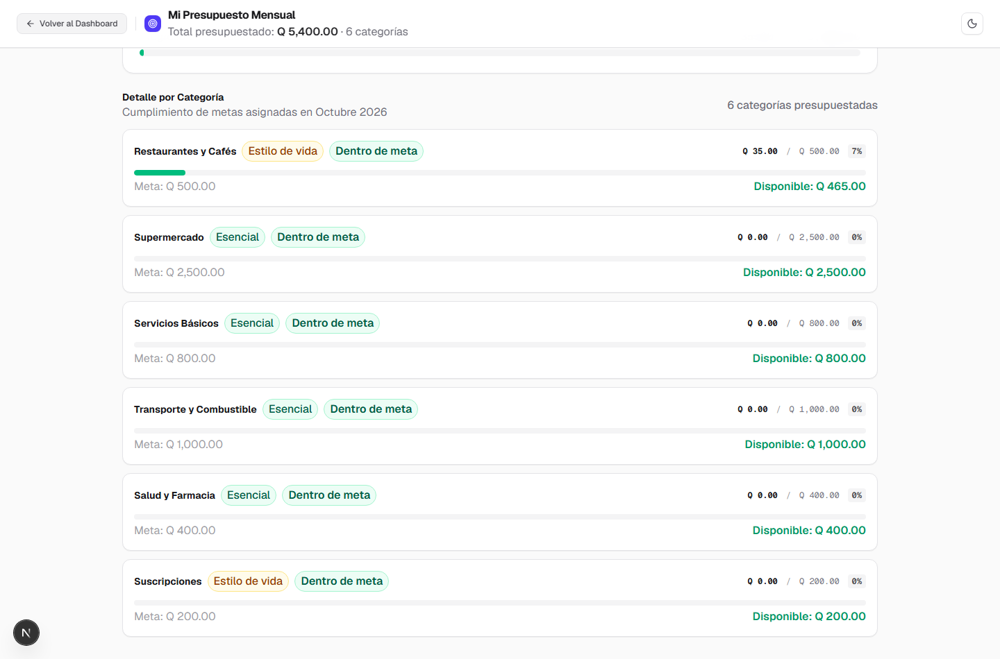
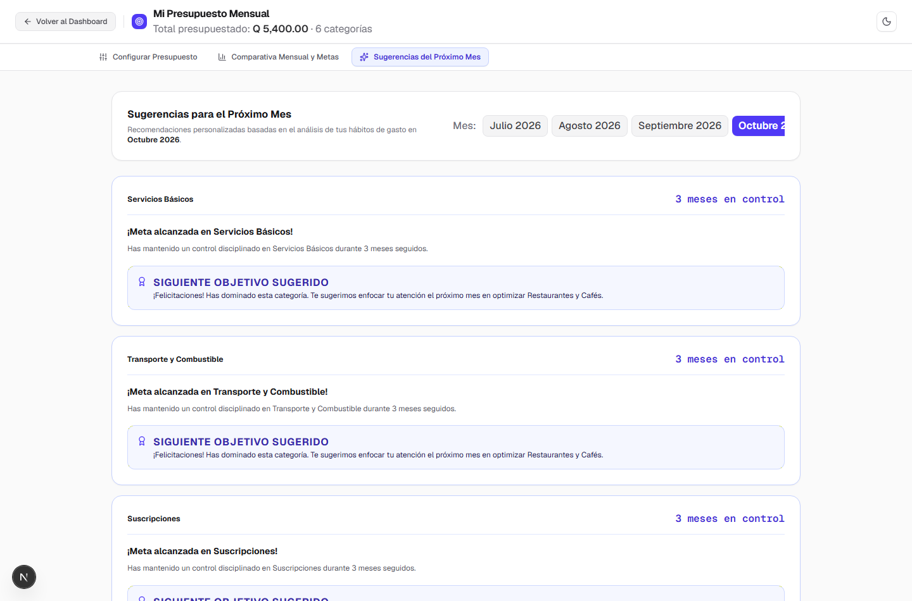
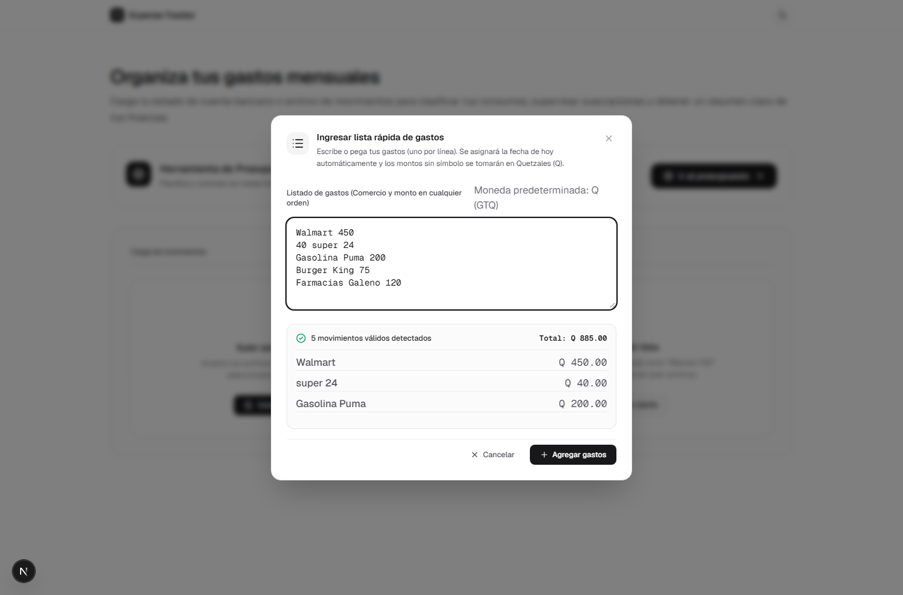
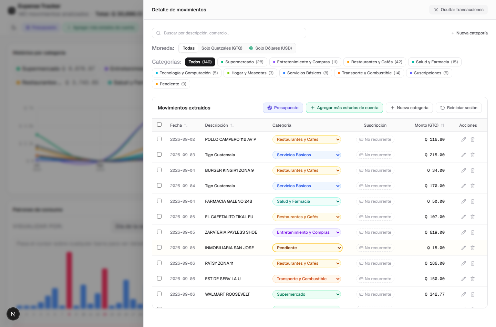

# Herramientas y Arquitectura Técnica

Este documento presenta la arquitectura técnica, las herramientas y las tecnologías que dan vida al proyecto **Control de Gastos (Expense Tracker)**, tomando como fuentes de verdad las especificaciones en `SPEC.md`, la descripción técnica en `ARCHITECTURE_DIAGRAM.md` y los diagramas del sistema.

---

## 1. Diagrama de Arquitectura del Sistema

La aplicación opera bajo el patrón de **Arquitectura Split-Brain**: todo el procesamiento bancario sensible, parseo de estados de cuenta, ingesta de listas en texto libre, cálculos presupuestarios y analítica financiera se ejecutan **100% de forma local** en el navegador y servidor local de Next.js. El modelo LLM en la nube (Google Gemini Pro) se invoca únicamente como un mecanismo de respaldo estrictamente protegido para formatos de documentos no reconocidos o clasificaciones complejas.

> El diagrama interactivo con capacidad de exportación a PNG y PDF se encuentra en [architecture-diagram.html](../architecture-diagram.html).

---

## 2. División de Responsabilidades por Capas

El sistema divide su carga de trabajo en tres niveles bien definidos:

### 2.1. ¿Qué sucede en el Navegador (Cliente)?

El cliente se ejecuta en React 19 y orquesta toda la interacción del usuario sin almacenar datos en servidores externos.

| Componente / Módulo del Cliente | Responsabilidad Técnica |
| :--- | :--- |
| **`src/app/page.tsx`** | Componente principal reactivo. Mantiene el estado global: lista de transacciones, continuidad de sesión, resumen de importación, categorías personalizadas, navegación entre Landing, Dashboard y Presupuesto, y contenedor de toasts. |
| **`dashboard-view.tsx`** | Vista de control financiero integrada. Organiza los 4 paneles analíticos en cuadrícula 2x2 responsiva, cabecera con acciones de carga, reinicio, switcher de tema, botón hacia el presupuesto y apertura del sliding drawer. |
| **`resizable-panel.tsx`** | Contenedor de paneles redimensionables en dos dimensiones (ancho y alto). Permite arrastrar divisores con persistencia en `localStorage` (`expense_tracker_panel_dims_v1`) y límites de seguridad. |
| **`sliding-drawer.tsx`** | Drawer lateral deslizante off-canvas (`z-50`) con backdrop desenfocado (`bg-black/40 backdrop-blur-sm`), soporte para tecla `Escape` y renderizado de la tabla completa de transacciones para triage sin perder de vista los gráficos. |
| **`category-trend-chart.tsx`** | Panel 1: Tendencia de Gastos por Categoría. Curvas Bézier cúbicas SVG, escala adaptativa, hit-targets circulares transparentes (`r=14`) para hover sin saltos ni parpadeos, etiquetas de fecha en dos líneas y selector interactivo. |
| **`vendor-concentration-chart.tsx`** | Panel 2: Concentración de Comercios. Barras horizontales con ranking top 5 de comercios en Guatemala, alternancia entre monto y frecuencia, ticket promedio y persistencia para ocultar comercios fijos. |
| **`consumption-patterns-chart.tsx`** | Panel 3: Patrones de Consumo. Barras verticales con selector de 7 días (semana) o 31 días (mes), detección estadística de anomalías ($\mu + 1.75\sigma$) resaltadas en rosa/ámbar e insights analíticos en español. |
| **`transaction-age-chart.tsx`** | Panel 4: Antigüedad del Gasto. Gráfico de dona SVG interactivo de 3 segmentos (Visacuotas, Suscripciones, Compras Inmediatas), selector desplegable de mes y tarjetas de leyenda sincronizadas con drill-down. |
| **`budget-tool-view.tsx`** | Vista dedicada del Planificador de Presupuestos. Pestañas de Configuración/Builder, Comparativa Real vs. Presupuestado y Sugerencias/Diagnósticos. |
| **`simple-list-modal.tsx`** | Modal para ingresar o pegar listas de compras informales en texto libre con conteo en vivo, totalizador en Quetzales y vista previa de transacciones válidas. |
| **`theme-toggle.tsx`** | Selector de tema Claro / Oscuro con persistencia automática en `localStorage` (`theme`) y manipulación de clases Tailwind en la raíz `<html>`. |
| **`file-validator.ts`** | Valida la extensión (`.pdf`, `.csv`), el tipo MIME y el tamaño del archivo antes de iniciar el procesamiento. |
| **`batch-processor.ts`** | Orquestador de cola de carga múltiple (PDF y CSV). Procesa lotes de archivos de forma secuencial reportando estado individual y progreso global. |
| **`text-list-parser.ts`** | Parser determinista de listas en texto plano (`"Walmart 150"`, `"40 super 24"`) con desambiguación contextual de números pertenecientes a nombres de marcas guatemaltecas. |
| **`budget-engine.ts`** | Motor presupuestario 100% local: plantillas por niveles (Esenciales vs. Estilo de vida), generador realista basado en historial, semáforo de estados (`under`, `near`, `over`, `way_over`), rachas semanales y diagnóstico de causas raíz. |
| **`deduplication.ts`** | Motor de deduplicación. Detecta y descarta automáticamente compras exactamente duplicadas tanto dentro del lote como frente a la sesión activa. |
| **`currency.ts`** | Motor de conversión y formateo de moneda. Convierte transacciones en dólares estadounidenses (`USD`) a Quetzales (`GTQ`) a la tasa activa (7.85), preservando la divisa original en metadatos. |
| **`csv-parser.ts` (PapaParse)** | Procesa archivos CSV en memoria de forma instantánea, infiriendo columnas de fecha, concepto, monto y divisa con mapeo interactivo de respaldo. |
| **`anonymizer.ts`** | Expresiones regulares y heurísticas para detectar y redactar información de identificación personal (PII): nombres, direcciones, cuentas, IBAN, DPI, NIT, teléfonos y correos. |
| **`anonymization-modal.tsx`** | Vista previa interactiva del texto extraído con las redacciones aplicadas y campo para añadir palabras clave manuales adicionales. |
| **`expense-classifier.ts`** | Compara descripciones contra `merchant-catalog.json` (12 categorías guatemaltecas, incluyendo Visacuotas y Financiamiento) y detecta suscripciones periódicas. |
| **`transaction-table.tsx`** | Tabla reactiva con búsqueda, filtros cruzados por categoría y moneda, edición en caliente de fechas/montos y asignación masiva de categorías. |
| **`reporting.ts`** | Motor analítico: series de tiempo multimes con interpolación Bézier, normalización de marcas y líneas base estadísticas de consumo. |
| **`storage.ts` (Browser localStorage)** | Persistencia de sesión (`expense_tracker_session_v1`), presupuestos (`expense_tracker_budget_v1`), categorías (`expense_tracker_categories_v1`) y dimensiones de paneles (`expense_tracker_panel_dims_v1`) con tolerancia a fallos y autorreparación. |

---

### Vistas de la Interfaz de Usuario

| Dashboard Analítico (Tema Claro) | Dashboard Analítico (Tema Oscuro) |
| :---: | :---: |
|  |  |

| Módulo de Presupuestos (Comparativa y Rachas) | Diagnóstico de Causas Raíz y Coaching |
| :---: | :---: |
|  |  |

| Ingesta de Lista Rápida en Texto | Panel Lateral de Movimientos (Sliding Drawer) |
| :---: | :---: |
|  |  |

---

### 2.2. ¿Qué sucede en el Servidor (Next.js Route Handlers)?

El servidor actúa como un procesador seguro y puente privado hacia la inteligencia artificial, ejecutándose en Node.js sobre la infraestructura de Vercel.

| Endpoint del Servidor | Método / Entrada | Procesamiento Interno | Respuesta al Cliente |
| :--- | :--- | :--- | :--- |
| **`/api/config`** | `GET` | Consulta las variables de entorno del servidor (`UNCLASSIFIED_EXPENSES_THRESHOLD`). | Retorna la configuración de ejecución (por defecto `unclassifiedExpensesThreshold: 10`). |
| **`/api/exchange-rate`** | `GET` | Consulta la tasa de cambio configurada en el entorno (`USD_GTQ_EXCHANGE_RATE`). | Retorna la tasa activa para conversión de dólares a Quetzales (por defecto `rate: 7.85`). |
| **`/api/parse-pdf`** | `POST` (Multipart FormData: archivo PDF) | Ejecuta `pdf-parse` de forma 100% local. Identifica y despacha automáticamente a parsers especializados de **tarjetas de crédito** para 7 bancos de Guatemala: • **Banco Industrial (BI)** (`bi-parser.ts`) • **Banco G&T Continental** (`gyt-parser.ts`) • **Banrural** (`banrural-parser.ts`) • **Banco Cuscatlán** (`cuscatlan-parser.ts`) • **BAC Credomatic** (`bac-parser.ts`) • **Banco FICOHSA** (`ficohsa-parser.ts`) • **Banco Agromercantil (BAM)** (`bam-parser.ts`) Convierte consumos en dólares a GTQ y filtra pagos de tarjeta y créditos. | Retorna transacciones estructuradas con metadatos de moneda o el texto plano en crudo con `isSupportedBank: false` si el banco no es compatible. |
| **`/api/extract-transactions`** | `POST` (JSON: `{ sanitizedText, bankName }`) | **Validación de frontera**: Invoca `validateSanitizedPayload` para rechazar cualquier texto con números de cuenta, IBAN, DPI o correos sin censurar. Invoca a **Google Gemini Pro** con el prompt de extracción financiera estricto. | Retorna transacciones parseadas en JSON clasificadas con el catálogo local. |
| **`/api/classify-expenses`** | `POST` (JSON: `{ unclassifiedTransactions, availableCategories }`) | **Validación de frontera**: Invoca `validateExpenseClassificationPayload` asegurando que solo viajen identificadores, descripciones y montos numéricos. Invoca a **Google Gemini Pro** con fallback de modelos (`gemini-3.8-flash` / `gemini-2.5-flash`) únicamente si los pendientes superan el umbral (10). | Retorna la lista de identificadores con categorías asignadas (`[{ id, category, isSubscription }]`). |
| **`/api/suggest-savings`** | `POST` (JSON: `{ totalSpendGTQ, categoryBreakdown, recurringExpenses }`) | **Validación de frontera**: Invoca `validateSavingsPayload` verificando que viajen únicamente datos numéricos consolidados y servicios recurrentes. Invoca a **Google Gemini Pro** para generar estrategias de ahorro adaptadas al contexto de Guatemala. | Retorna el análisis financiero estructurado: oportunidades inmediatas, metas de mediano plazo y comparativas de categorías. |

---

### 2.3. ¿Qué se envía al LLM Externo (Google Gemini)?

Bajo la arquitectura Split-Brain, el modelo en la nube jamás recibe archivos PDF, hojas CSV, identidades personales o información transaccional sensible:

| Caso de Uso del LLM | Datos Exactos Enviados al Modelo | Datos Excluidos y Protegidos | Formato Esperado de Retorno |
| :--- | :--- | :--- | :--- |
| **1. Extracción de Bancos No Soportados** | Texto crudo del estado de cuenta con **todos los datos de identidad anonimizados** con marcadores: • `[NOMBRE_REDACTADO]` • `[CUENTA_REDACTADA]` • `[DIRECCION_REDACTADA]` • `[IDENTIFICACION_REDACTADA]` • `[CONTACTO_REDACTADO]` | Archivo binario original, nombres reales del titular, números de cuenta bancaria o IBAN, DPI, NIT, teléfonos, direcciones físicas de residencia y correos. | Array JSON de transacciones válidas: `[{"date": "YYYY-MM-DD", "description": "...", "amount": 0.00}]` |
| **2. Clasificación de Gastos Pendientes** | • Lista de categorías válidas en español (12 categorías estándar más personalizadas). • Array de movimientos pendientes conteniendo **únicamente**: `id`, `description` (sanitizada) y `amount` en Quetzales. Solo si los pendientes superan el umbral (10). | Nombres del titular, números de cuenta, saldos bancarios, historial previo o cualquier identificador fuera de la transacción puntual. | Array JSON de categorías asignadas: `[{"id": "...", "category": "...", "isSubscription": false}]` |
| **3. Recomendaciones de Ahorro** | • Total de gasto del período en Quetzales (`totalSpendGTQ`). • Desglose consolidado por categoría (monto total y porcentaje). • Lista de servicios de suscripción recurrentes identificados (`serviceName`, `monthlyAmountGTQ`, `chargeDate`). | Todas las transacciones individuales no recurrentes, estados de cuenta, nombres del titular, direcciones y datos bancarios. | Objeto JSON estructurado en español con oportunidades inmediatas, estrategias de ahorro y diagnóstico por categoría. |

---

## 3. Stack de Tecnologías

| Tecnología / Herramienta | Versión | Rol en el Proyecto y Justificación |
| :--- | :--- | :--- |
| **Next.js** | `16.4.3` | Framework web full-stack con App Router y Turbopack. Route Handlers en Node.js que aíslan las credenciales de API del navegador del cliente y gestionan el procesamiento de archivos. |
| **React** | `19.3.0` | Biblioteca de interfaz de usuario reactiva, permitiendo un manejo fluido del estado de la sesión, modales interactivos, dashboard de 4 paneles SVG, módulo de presupuestos y drawer lateral. |
| **TypeScript** | `5.x` | Tipado estático en todo el proyecto, garantizando contratos de datos sólidos (`Transaction`, `CategoryBudget`, `StoredBudgetState`, etc.) y reduciendo errores en tiempo de ejecución. |
| **Tailwind CSS** | `4.x` | Sistema de diseño utilitario para construir una interfaz limpia, profesional, responsiva y adaptable a modo claro y oscuro sin CSS innecesario. |
| **Google Gen AI SDK** (`@google/genai`) | `^2.28.0` | SDK oficial de Google para comunicación estructurada con Gemini Pro (`gemini-3.8-flash` y `gemini-2.5-flash`), permitiendo respuestas en formato JSON estricto. |
| **pdf-parse** | `^2.4.5` | Motor local para extracción de texto a partir de búferes binarios de documentos PDF sin recurrir a dependencias nativas complejas. |
| **PapaParse** | `^5.7.0` | Parser rápido y robusto de archivos CSV en el navegador, con detección automática de delimitadores, filas vacías y codificación. |
| **Lucide React** | `^1.55.0` | Colección de iconos vectoriales SVG limpios y consistentes, manteniendo la regla de diseño de evitar emojis en la interfaz. |
| **Node.js Test Runner + tsx** | `Node 22` / `tsx ^4.23` | Plataforma nativa de pruebas unitarias de alto rendimiento (291 pruebas en 58 suites) sin requerir configuración compleja de frameworks pesados. |
| **Playwright** | `^1.56.0` | Suite de pruebas End-to-End automatizadas para validación desatendida del flujo completo, carga de PDFs reales, reactividad del dashboard, presupuesto y drawer. |
| **Vercel** | N/A | Plataforma de alojamiento y despliegue continuo (CI/CD) optimizada para el App Router de Next.js. |

---

## Enlaces de Referencia

* [Volver al README Principal](../README.md)
* [Implementación del Módulo de Presupuestos](dev/iteration_4/BUDGET_IMPLEMENTATION.md)
* [Encuesta de Evaluación de Producto](../ENCUESTA.md)
* [Diagrama de Arquitectura y Flujos](../ARCHITECTURE_DIAGRAM.md)
* [Instalación, Configuración y Ejecución](instalacion-y-ejecucion.md)
* [Estructura del Proyecto](estructura-del-proyecto.md)
* [Arquitectura Split-Brain](arquitectura-split-brain.md)
* [Uso del LLM Externo y Manejo de Fallos](uso-del-llm-y-manejo-de-fallos.md)
* [Privacidad y Anonimización de Datos](privacidad-y-anonimizacion.md)
* [Pruebas Unitarias y Cobertura](pruebas-unitarias.md)
