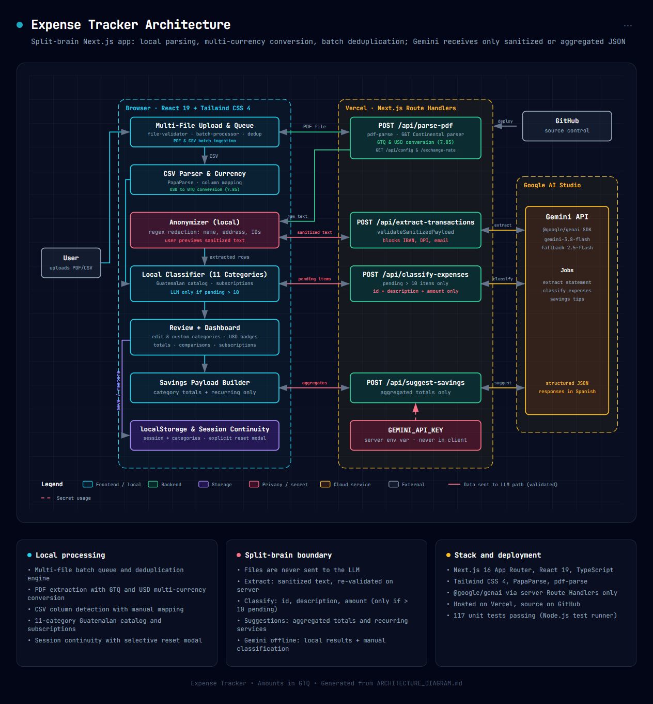

# Herramientas y Arquitectura Técnica

Este documento presenta la arquitectura técnica, las herramientas y las tecnologías que dan vida al proyecto **Control de Gastos (Expense Tracker)**, tomando como fuentes de verdad las especificaciones en `SPEC.md`, la descripción técnica en `ARCHITECTURE_DIAGRAM.md` y los diagramas del sistema.

---

## 1. Diagrama de Arquitectura del Sistema

La arquitectura está construida sobre un modelo moderno de Next.js (App Router) desplegado en Vercel, combinando ejecución en el cliente (navegador), ejecución en el servidor interno (Node.js Route Handlers) y servicios en la nube (Google Gemini Pro):

> **Diagrama Interactivo**: Si deseas explorar los componentes interactivos con detalles de conexión y flujo de datos, abre el archivo [architecture-diagram.html](../architecture-diagram.html) en tu navegador web.

---

## 2. División de Responsabilidades por Capas

Para comprender con exactitud qué sucede en cada entorno de ejecución, el sistema divide su carga de trabajo en tres niveles bien definidos:

### 2.1. ¿Qué sucede en el Navegador (Cliente)?

El cliente se ejecuta en React 19 y orquesta toda la interacción del usuario sin almacenar datos en servidores externos.

| Componente / Módulo del Cliente | Responsabilidad Técnica |
| :--- | :--- |
| **`src/app/page.tsx`** | Componente principal reactivo. Mantiene el estado global: lista de transacciones, resumen de importación, categorías personalizadas, recomendaciones de ahorro, estado de modales y alertas. |
| **`file-validator.ts`** | Valida la extensión (`.pdf`, `.csv`), el tipo MIME y el tamaño del archivo antes de iniciar el procesamiento. |
| **`csv-parser.ts` (PapaParse)** | Procesa archivos CSV en memoria del navegador de forma instantánea. Detecta automáticamente columnas de fecha, descripción y monto; si existe ambigüedad, solicita confirmación al usuario. |
| **`anonymizer.ts`** | Aplica expresiones regulares y heurísticas para detectar y redactar información de identificación personal (PII): nombres, direcciones, cuentas, IBAN, DPI, NIT, teléfonos y correos. |
| **`anonymization-modal.tsx`** | Renderiza una vista previa del texto extraído con las redacciones aplicadas, métricas de datos censurados y un campo para que el usuario añada palabras clave manuales adicionales. |
| **`expense-classifier.ts`** | Compara descripciones de transacciones contra `merchant-catalog.json` de comercios guatemaltecos. Identifica suscripciones recurrentes y evalúa si los gastos pendientes superan el umbral (5). |
| **`transaction-table.tsx`** | Permite al usuario revisar, buscar, filtrar por categoría, editar montos/fechas, cambiar categorías de forma individual o masiva, marcar suscripciones y eliminar registros. |
| **`expense-dashboard.tsx`** | Calcula y renderiza gráficos de distribución presupuestaria, porcentajes por categoría, comparativas de gastos y alertas de suscripciones. |
| **`savings-advisor.ts` (Payload Builder)** | Construye el objeto JSON estrictamente agregado (totales por categoría y servicios recurrentes) para la solicitud de recomendaciones de ahorro. |
| **`storage.ts` (Browser localStorage)** | Persiste y restaura la sesión activa (`expense_tracker_session_v1`) y las categorías personalizadas (`expense_tracker_categories_v1`) con manejo de cuota y resiliencia ante datos corruptos. |

---

### 2.2. ¿Qué sucede en el Servidor (Next.js Route Handlers)?

El servidor actúa como un procesador seguro y puente privado hacia la inteligencia artificial, ejecutándose en Node.js sobre la infraestructura de Vercel.

| Endpoint del Servidor | Método / Entrada | Procesamiento Interno | Respuesta al Cliente |
| :--- | :--- | :--- | :--- |
| **`/api/parse-pdf`** | `POST` (Multipart FormData: archivo PDF) | Ejecuta `pdf-parse` de forma 100% local (sin llamadas externas). Detecta el banco del estado de cuenta: • Si es **Banco G&T Continental**, ejecuta el parser especializado `parseGyTStatementText` que filtra cobros en dólares, créditos y pagos de tarjeta. • Si es otro banco, extrae el texto plano. | Retorna transacciones estructuradas (si el banco es compatible) o el texto plano en crudo junto con la bandera `isSupportedBank: false` (si no es compatible). |
| **`/api/extract-transactions`** | `POST` (JSON: `{ sanitizedText, bankName }`) | **Validación de frontera**: Invoca `validateSanitizedPayload` para rechazar cualquier texto que contenga números de cuenta, IBAN, DPI o correos sin censurar. Invoca a **Google Gemini Pro** con el system prompt de extracción financiera estricto. | Retorna el listado JSON de transacciones parseadas (`date`, `description`, `amount`) ya clasificadas con el catálogo local. |
| **`/api/classify-expenses`** | `POST` (JSON: `{ unclassifiedTransactions, availableCategories }`) | **Validación de frontera**: Invoca `validateExpenseClassificationPayload` asegurando que solo viajen identificadores, descripciones de comercios y montos numéricos. Invoca a **Google Gemini Pro** con estrategia de fallback de modelos (`gemini-3.8-flash` / `gemini-2.5-flash`). | Retorna la lista de identificadores con sus categorías asignadas (`[{ id, category, isSubscription }]`). |
| **`/api/suggest-savings`** | `POST` (JSON: `{ totalSpendGTQ, categoryBreakdown, recurringExpenses }`) | **Validación de frontera**: Invoca `validateSavingsPayload` verificando que el payload contenga únicamente datos numéricos consolidados y servicios recurrentes. Invoca a **Google Gemini Pro** para generar estrategias de ahorro adaptadas al mercado de Guatemala. | Retorna el análisis financiero estructurado: oportunidades inmediatas, estrategias a largo plazo y comparativas de categorías. |

---

### 2.3. ¿Qué se envía al LLM Externo (Google Gemini)?

Bajo la arquitectura Split-Brain, el modelo en la nube jamás recibe archivos PDF, hojas CSV, identidades personales o información transaccional sensible:

| Caso de Uso del LLM | Datos Exactos Enviados al Modelo | Datos Excluidos y Protegidos | Formato Esperado de Retorno |
| :--- | :--- | :--- | :--- |
| **1. Extracción de Bancos No Soportados** | Texto crudo del estado de cuenta con **todos los datos de identidad anonimizados** con marcadores: • `[NOMBRE_REDACTADO]` • `[CUENTA_REDACTADA]` • `[DIRECCION_REDACTADA]` • `[IDENTIFICACION_REDACTADA]` • `[CONTACTO_REDACTADO]` | Archivo binario original, nombres reales del titular, números de cuenta bancaria o IBAN, DPI, NIT, teléfonos, direcciones físicas de residencia y correos. | Array JSON de transacciones válidas: `[{"date": "YYYY-MM-DD", "description": "...", "amount": 0.00}]` |
| **2. Clasificación de Gastos Pendientes** | • Lista de categorías válidas en español. • Array de movimientos pendientes conteniendo **únicamente**: `id`, `description` (sanitizada) y `amount` en Quetzales. | Nombres del titular, números de cuenta, saldos bancarios, historial previo o cualquier identificador fuera de la transacción puntual. | Array JSON de categorías asignadas: `[{"id": "...", "category": "...", "isSubscription": false}]` |
| **3. Recomendaciones de Ahorro** | • Total de gasto del período en Quetzales (`totalSpendGTQ`). • Desglose consolidado por categoría (monto total y porcentaje). • Lista de servicios de suscripción recurrentes identificados (`serviceName`, `monthlyAmountGTQ`, `chargeDate`). | Todas las transacciones individuales no recurrentes, estados de cuenta, nombres del titular, direcciones y datos bancarios. | Objeto JSON estructurado en español con oportunidades inmediatas, estrategias de ahorro y diagnóstico por categoría. |

---

## 3. Pila Tecnológica y Herramientas

| Tecnología / Herramienta | Versión | Rol en el Proyecto y Justificación |
| :--- | :--- | :--- |
| **Next.js** | `16.4.0` | Framework web full-stack con App Router. Permite ejecutar Route Handlers en Node.js que aíslan las credenciales de API del navegador del cliente y gestionan el procesamiento de archivos. |
| **React** | `19.3.0` | Biblioteca de interfaz de usuario reactiva, permitiendo un manejo fluido del estado de la sesión, modales interactivos y renderizado en tiempo real. |
| **TypeScript** | `5.x` | Tipado estático en todo el proyecto, garantizando contratos de datos sólidos (`Transaction`, `SavingsPayload`, etc.) y reduciendo errores en tiempo de ejecución. |
| **Tailwind CSS** | `4.x` | Sistema de diseño utilitario para construir una interfaz limpia, profesional, responsiva y adaptable a modo claro y oscuro sin CSS innecesario. |
| **Google Gen AI SDK** (`@google/genai`) | `^2.28.0` | SDK oficial de Google para comunicación estructurada con Gemini Pro (`gemini-3.8-flash` y `gemini-2.5-flash`), permitiendo respuestas en formato JSON estricto. |
| **pdf-parse** | `^2.4.5` | Motor local para extracción de texto a partir de búferes binarios de documentos PDF sin recurrir a dependencias nativas complejas. |
| **PapaParse** | `^5.7.0` | Parser rápido y robusto de archivos CSV en el navegador, con detección automática de delimitadores, filas vacías y codificación. |
| **Lucide React** | `^1.55.0` | Colección de iconos vectoriales SVG limpios y consistentes, manteniendo la regla de diseño de evitar emojis en la interfaz. |
| **Node.js Test Runner + tsx** | `Node 22` / `tsx ^4.23` | Plataforma nativa de pruebas unitarias de alto rendimiento sin requerir configuración compleja de Jest o Vitest. |
| **Vercel** | N/A | Plataforma de alojamiento y despliegue continuo (CI/CD) optimizada para el App Router de Next.js. |

---

## Enlaces de Referencia

* [Volver al README Principal](../README.md)
* [Instalación, Configuración y Ejecución](instalacion-y-ejecucion.md)
* [Estructura del Proyecto](estructura-del-proyecto.md)
* [Arquitectura Split-Brain](arquitectura-split-brain.md)
* [Uso del LLM Externo y Manejo de Fallos](uso-del-llm-y-manejo-de-fallos.md)
* [Privacidad y Anonimización de Datos](privacidad-y-anonimizacion.md)
* [Pruebas Unitarias y Cobertura](pruebas-unitarias.md)
