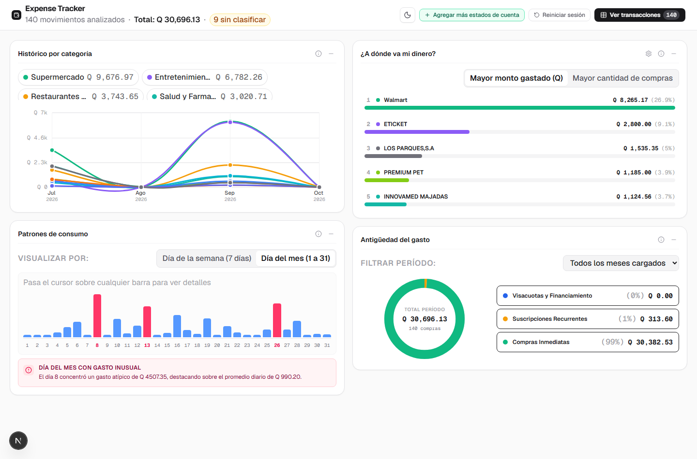
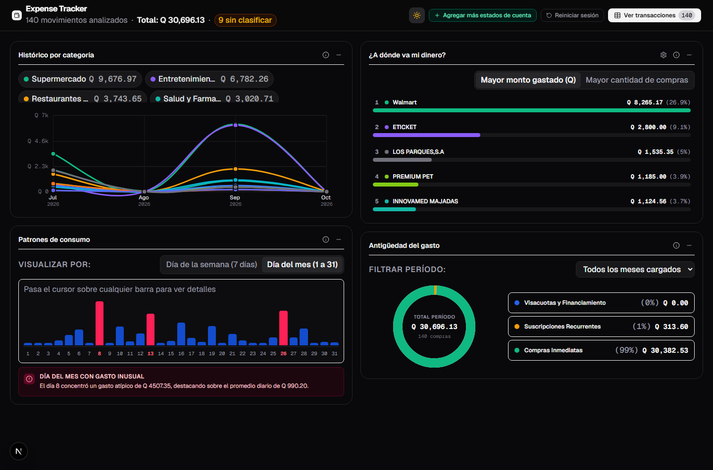
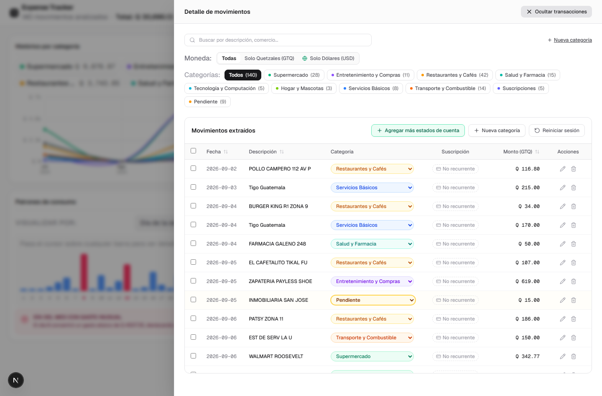

# Herramientas y Arquitectura Técnica

Este documento presenta la arquitectura técnica, las herramientas y las tecnologías que dan vida al proyecto **Control de Gastos (Expense Tracker)**, tomando como fuentes de verdad las especificaciones en `SPEC.md`, la descripción técnica en `ARCHITECTURE_DIAGRAM.md` y los diagramas del sistema.

---

## 1. Diagrama de Arquitectura del Sistema

La arquitectura está construida sobre un modelo moderno de Next.js (App Router) desplegado en Vercel, combinando ejecución en el cliente (navegador), ejecución en el servidor interno (Node.js Route Handlers) y servicios en la nube (Google Gemini Pro):

---

## 2. División de Responsabilidades por Capas

Para comprender con exactitud qué sucede en cada entorno de ejecución, el sistema divide su carga de trabajo en tres niveles bien definidos:

### 2.1. ¿Qué sucede en el Navegador (Cliente)?

El cliente se ejecuta en React 19 y orquesta toda la interacción del usuario sin almacenar datos en servidores externos.

| Componente / Módulo del Cliente | Responsabilidad Técnica |
| :--- | :--- |
| **`src/app/page.tsx`** | Componente principal reactivo. Mantiene el estado global: lista acumulada de transacciones, continuidad de sesión, resumen de importación, categorías personalizadas, recomendaciones de ahorro, estado de modales, contenedor de toasts y navegación directa al dashboard. |
| **`dashboard-view.tsx`** | Vista de control financiero integrada. Organiza los 4 paneles analíticos en cuadrícula 2x2 responsiva (`grid-cols-1 lg:grid-cols-2`), cabecera con acciones de carga, reinicio, switcher de tema y botón de apertura del sliding drawer. |
| **`sliding-drawer.tsx`** | Drawer lateral deslizante off-canvas (`z-50`) con backdrop desenfocado (`bg-black/40 backdrop-blur-sm`), soporte para tecla `Escape` y renderizado de la tabla completa de transacciones para triage sin perder de vista los gráficos. |
| **`category-trend-chart.tsx`** | Panel 1: Tendencia de Gastos por Categoría. Curvas Bézier cúbicas SVG, escala adaptativa, hit-targets circulares transparentes (`r=14`) para hover sin saltos ni parpadeos, etiquetas de fecha en dos líneas (`Ene\n2026`) y selector de categorías interactivo. |
| **`vendor-concentration-chart.tsx`** | Panel 2: Concentración de Comercios. Barras horizontales con ranking top 5 de comercios normalizados en Guatemala y alternancia entre monto total en Quetzales y frecuencia de visitas. |
| **`consumption-patterns-chart.tsx`** | Panel 3: Patrones de Consumo. Barras verticales con selector de 7 días (semana) o 31 días (mes), detección estadística de anomalías ($\mu + 1.75\sigma$) resaltadas en color rosa/ámbar e insights analíticos en español. |
| **`transaction-age-chart.tsx`** | Panel 4: Antigüedad del Gasto. Gráfico de dona SVG interactivo de 3 segmentos (Visacuotas, Suscripciones, Compras Inmediatas), selector desplegable de mes y tarjetas de leyenda sincronizadas. |
| **`theme-toggle.tsx`** | Selector de tema Claro / Oscuro con modo claro por defecto, persistencia automática en `localStorage` (`theme`) y manipulación de clases Tailwind en la raíz `<html>`. |
| **`file-validator.ts`** | Valida la extensión (`.pdf`, `.csv`), el tipo MIME y el tamaño del archivo antes de iniciar el procesamiento. |
| **`batch-processor.ts`** | Orquestador de cola de carga múltiple (PDF y CSV). Procesa lotes de archivos de forma secuencial y ordenada reportando estado individual (`pending`, `processing`, `completed`, `error`) y progreso global. |
| **`deduplication.ts`** | Motor de deduplicación de transacciones. Detecta y descarta automáticamente compras exactamente duplicadas (misma fecha, descripción idéntica y mismo monto) tanto dentro del lote como frente a la sesión activa, preservando coincidencias parciales legítimas y notificando al usuario. |
| **`currency.ts`** | Motor de conversión y formateo de moneda. Convierte transacciones facturadas en dólares estadounidenses (`USD`) a Quetzales (`GTQ`) utilizando la tasa de cambio configurable (por defecto Q 7.85 por USD), preservando el monto y divisa original en metadatos para visualización y filtrado. |
| **`csv-parser.ts` (PapaParse)** | Procesa archivos CSV en memoria del navegador de forma instantánea. Detecta automáticamente columnas de fecha, descripción, monto y moneda; si existe ambigüedad, solicita confirmación al usuario mediante mapeo interactivo. |
| **`anonymizer.ts`** | Aplica expresiones regulares y heurísticas para detectar y redactar información de identificación personal (PII): nombres, direcciones, cuentas, IBAN, DPI, NIT, teléfonos y correos. |
| **`anonymization-modal.tsx`** | Renderiza una vista previa del texto extraído con las redacciones aplicadas, métricas de datos censurados y un campo para que el usuario añada palabras clave manuales adicionales. |
| **`expense-classifier.ts`** | Compara descripciones de transacciones contra `merchant-catalog.json` (12 categorías de comercios guatemaltecos, incluyendo Visacuotas y Financiamiento). Identifica suscripciones recurrentes y evalúa si los gastos pendientes superan el umbral configurado (10 por defecto). |
| **`transaction-table.tsx`** | Permite al usuario revisar, buscar, filtrar por categoría y por moneda (Todas, Solo GTQ, Convertidas de USD), editar montos/fechas, cambiar categorías de forma individual o masiva, marcar suscripciones y eliminar registros. |
| **`reporting.ts`** | Motor analítico local: calcula series de tiempo multimes con relleno de ceros, normalización de marcas/comercios, líneas base estadísticas de consumo semanal/mensual y segmentación de compromisos de antigüedad. |
| **`expense-dashboard.tsx`** | `[@deprecated]` Panel analítico con tarjetas de métricas iniciales, conservado para compatibilidad y reemplazado por `DashboardView`. |
| **`savings-advisor.ts` (Payload Builder)** | Construye el objeto JSON estrictamente agregado (totales por categoría y servicios recurrentes) para la solicitud de recomendaciones de ahorro. |
| **`storage.ts` (Browser localStorage)** | Persiste y restaura la sesión activa (`expense_tracker_session_v1`) y las categorías personalizadas (`expense_tracker_categories_v1`) con continuidad incremental, detección de cuota, resiliencia ante datos corruptos y soporte para reinicio de sesión selectivo (conservando categorías personalizadas) o reinicio de fábrica. |

#### Vistas de la Interfaz de Usuario

| Dashboard Analítico (Tema Claro) | Dashboard Analítico (Tema Oscuro) |
| :---: | :---: |
|  |  |

| Panel Lateral de Movimientos (Sliding Drawer) |
| :---: |
|  |

---

### 2.2. ¿Qué sucede en el Servidor (Next.js Route Handlers)?

El servidor actúa como un procesador seguro y puente privado hacia la inteligencia artificial, ejecutándose en Node.js sobre la infraestructura de Vercel.

| Endpoint del Servidor | Método / Entrada | Procesamiento Interno | Respuesta al Cliente |
| :--- | :--- | :--- | :--- |
| **`/api/config`** | `GET` | Consulta las variables de entorno del servidor (como `UNCLASSIFIED_EXPENSES_THRESHOLD`). | Retorna la configuración de ejecución (por defecto `unclassifiedExpensesThreshold: 10`). |
| **`/api/exchange-rate`** | `GET` | Consulta la tasa de cambio configurada en el entorno (`USD_GTQ_EXCHANGE_RATE`). | Retorna la tasa de cambio activa para conversión de dólares a Quetzales (por defecto `rate: 7.85`). |
| **`/api/parse-pdf`** | `POST` (Multipart FormData: archivo PDF) | Ejecuta `pdf-parse` de forma 100% local (sin llamadas externas). Detecta el banco del estado de cuenta: • Si es **Banco G&T Continental**, ejecuta el parser especializado `parseGyTStatementText` extrayendo tanto consumos en Quetzales como consumos en dólares convertidos a GTQ (7.85), filtrando créditos y pagos de tarjeta. • Si es otro banco, extrae el texto plano. | Retorna transacciones estructuradas con metadatos de moneda original (si el banco es compatible) o el texto plano en crudo junto con la bandera `isSupportedBank: false` (si no es compatible). |
| **`/api/extract-transactions`** | `POST` (JSON: `{ sanitizedText, bankName }`) | **Validación de frontera**: Invoca `validateSanitizedPayload` para rechazar cualquier texto que contenga números de cuenta, IBAN, DPI o correos sin censurar. Invoca a **Google Gemini Pro** con el system prompt de extracción financiera estricto. | Retorna el listado JSON de transacciones parseadas (`date`, `description`, `amount`) ya clasificadas con el catálogo local. |
| **`/api/classify-expenses`** | `POST` (JSON: `{ unclassifiedTransactions, availableCategories }`) | **Validación de frontera**: Invoca `validateExpenseClassificationPayload` asegurando que solo viajen identificadores, descripciones de comercios y montos numéricos. Invoca a **Google Gemini Pro** con estrategia de fallback de modelos (`gemini-3.8-flash` / `gemini-2.5-flash`). Se ejecuta únicamente si los pendientes superan el umbral (10). | Retorna la lista de identificadores con sus categorías asignadas (`[{ id, category, isSubscription }]`). |
| **`/api/suggest-savings`** | `POST` (JSON: `{ totalSpendGTQ, categoryBreakdown, recurringExpenses }`) | **Validación de frontera**: Invoca `validateSavingsPayload` verificando que el payload contenga únicamente datos numéricos consolidados y servicios recurrentes. Invoca a **Google Gemini Pro** para generar estrategias de ahorro adaptadas al mercado de Guatemala. | Retorna el análisis financiero estructurado: oportunidades inmediatas, estrategias a largo plazo y comparativas de categorías. |

---

### 2.3. ¿Qué se envía al LLM Externo (Google Gemini)?

Bajo la arquitectura Split-Brain, el modelo en la nube jamás recibe archivos PDF, hojas CSV, identidades personales o información transaccional sensible:

| Caso de Uso del LLM | Datos Exactos Enviados al Modelo | Datos Excluidos y Protegidos | Formato Esperado de Retorno |
| :--- | :--- | :--- | :--- |
| **1. Extracción de Bancos No Soportados** | Texto crudo del estado de cuenta con **todos los datos de identidad anonimizados** con marcadores: • `[NOMBRE_REDACTADO]` • `[CUENTA_REDACTADA]` • `[DIRECCION_REDACTADA]` • `[IDENTIFICACION_REDACTADA]` • `[CONTACTO_REDACTADO]` | Archivo binario original, nombres reales del titular, números de cuenta bancaria o IBAN, DPI, NIT, teléfonos, direcciones físicas de residencia y correos. | Array JSON de transacciones válidas: `[{"date": "YYYY-MM-DD", "description": "...", "amount": 0.00}]` |
| **2. Clasificación de Gastos Pendientes** | • Lista de categorías válidas en español (12 categorías estándar incluyendo Visacuotas, más personalizadas). • Array de movimientos pendientes conteniendo **únicamente**: `id`, `description` (sanitizada) y `amount` en Quetzales. Solo se envía si el número de pendientes supera el umbral (10). | Nombres del titular, números de cuenta, saldos bancarios, historial previo o cualquier identificador fuera de la transacción puntual. | Array JSON de categorías asignadas: `[{"id": "...", "category": "...", "isSubscription": false}]` |
| **3. Recomendaciones de Ahorro** | • Total de gasto del período en Quetzales (`totalSpendGTQ`). • Desglose consolidado por categoría (monto total y porcentaje). • Lista de servicios de suscripción recurrentes identificados (`serviceName`, `monthlyAmountGTQ`, `chargeDate`). | Todas las transacciones individuales no recurrentes, estados de cuenta, nombres del titular, direcciones y datos bancarios. | Objeto JSON estructurado en español con oportunidades inmediatas, estrategias de ahorro y diagnóstico por categoría. |

---

## 3. Stack de Tecnologías

| Tecnología / Herramienta | Versión | Rol en el Proyecto y Justificación |
| :--- | :--- | :--- |
| **Next.js** | `16.4.0` | Framework web full-stack con App Router. Permite ejecutar Route Handlers en Node.js que aíslan las credenciales de API del navegador del cliente y gestionan el procesamiento de archivos. |
| **React** | `19.3.0` | Biblioteca de interfaz de usuario reactiva, permitiendo un manejo fluido del estado de la sesión, modales interactivos, dashboard de 4 paneles SVG y drawer lateral. |
| **TypeScript** | `5.x` | Tipado estático en todo el proyecto, garantizando contratos de datos sólidos (`Transaction`, `MonthlyCategoryTrend`, etc.) y reduciendo errores en tiempo de ejecución. |
| **Tailwind CSS** | `4.x` | Sistema de diseño utilitario para construir una interfaz limpia, profesional, responsiva y adaptable a modo claro y oscuro sin CSS innecesario. |
| **Google Gen AI SDK** (`@google/genai`) | `^2.28.0` | SDK oficial de Google para comunicación estructurada con Gemini Pro (`gemini-3.8-flash` y `gemini-2.5-flash`), permitiendo respuestas en formato JSON estricto. |
| **pdf-parse** | `^2.4.5` | Motor local para extracción de texto a partir de búferes binarios de documentos PDF sin recurrir a dependencias nativas complejas. |
| **PapaParse** | `^5.7.0` | Parser rápido y robusto de archivos CSV en el navegador, con detección automática de delimitadores, filas vacías y codificación. |
| **Lucide React** | `^1.55.0` | Colección de iconos vectoriales SVG limpios y consistentes, manteniendo la regla de diseño de evitar emojis en la interfaz. |
| **Node.js Test Runner + tsx** | `Node 22` / `tsx ^4.23` | Plataforma nativa de pruebas unitarias de alto rendimiento sin requerir configuración compleja de Jest o Vitest. |
| **Playwright** | `^1.56.0` | Suite de pruebas End-to-End automatizadas para validación desatendida del flujo completo, carga de PDFs reales, reactividad del dashboard y drawer. |
| **Vercel** | N/A | Plataforma de alojamiento y despliegue continuo (CI/CD) optimizada para el App Router de Next.js. |

---

## Enlaces de Referencia

* [Volver al README Principal](../README.md)
* [Instalación, Configuración y Ejecución](instalacion-y-ejecucion.md)
* [Estructura del Proyecto](estructura-del-proyecto.md)
* [Arquitectura Split-Brain](arquitectura-split-brain.md)
* [Uso del LLM Externo y Manejo de Fallos](uso-del-llm-y-manejo-de-fallos.md)
* [Privacidad y Anonimización de Datos](privacidad-y-anonimizacion.md)
* [Pruebas Unitarias y Cobertura](pruebas-unitarias.md)
